# Отчет по лабораторной работе № 1

**Дисциплина:** Разработка web-приложений

**Выполнила:** студентка группы ПИЖ-б-о-25-1 (1), направление подготовки: 09.03.04 «Программная инженерия» Попова Виктория Романовна

**Проверила:** ассистент кафедры программной инженерии института информационных технологий и кибербезопасности Белик Ангелина Игоревна

**Тема:** Создание виртуального окружения. Контроллеры и маршруты

*Ставрополь, 2026*

---

## Содержание

1. [Цель работы](#цель-работы)
2. [Ход выполнения лабораторной работы](#ход-выполнения-лабораторной-работы)
3. [Вывод](#вывод)

---

## Цель работы

Настроить виртуальное пространство. Разработать контроллер приложения и организовать маршруты.

---

## Ход выполнения лабораторной работы

### 1. Создание виртуального окружения

Для выполнения лабораторной работы был использован второй способ создания виртуального окружения – автоматическое создание средствами системы программирования PyCharm.

В папке `MyProject` появится папка `.venv` вашего виртуального окружения (рис. 1).

После создания окружения его необходимо активировать. Для этого в терминале PyCharm была выполнена команда:

```bash
.venv\Scripts\activate
```

Признаком успешной активации является появление в начале строки терминала имени окружения в круглых скобках (рис. 1):

```bash
(.venv) PS C:\Users\user\Desktop\MyProject>
```

<p align="center"> 
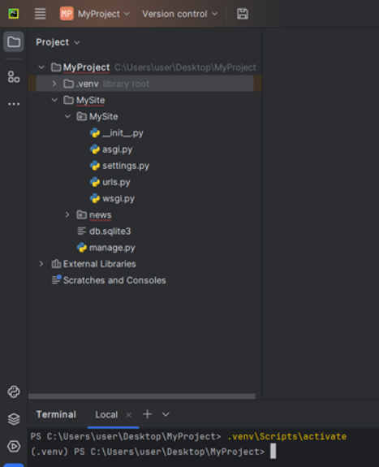 
<br> <em>Рисунок 1 – Создание виртуального окружения и его успешная активация</em> 
</p>

Для проверки списка установленных в окружении пакетов использовалась команда:

```bash
pip list
```

На данном этапе в списке присутствовали только базовые пакеты (pip, setuptools, wheel) (рис. 2).

<p align="center"> 
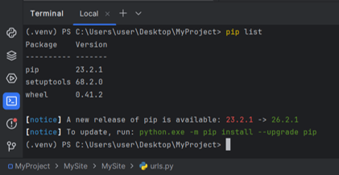 
<br> <em>Рисунок 2 – Проверка списка установленных пакетов через команду pip list</em> 
</p>

### 2. Установка фреймворка Django

Установочный пакет Django находится в открытом репозитории Python-пакетов по адресу pypi.org.

<p align="center"> 
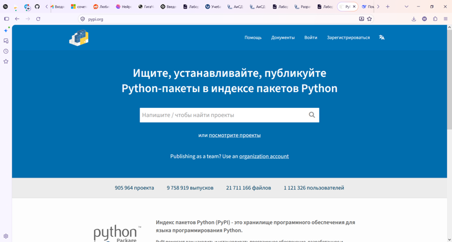 
<br> <em>Рисунок 3 – Установочный пакет Django</em> 
</p>

В поисковой строке введено `Django` и в списке выбрана последняя версия (рис. 4).

<p align="center"> 
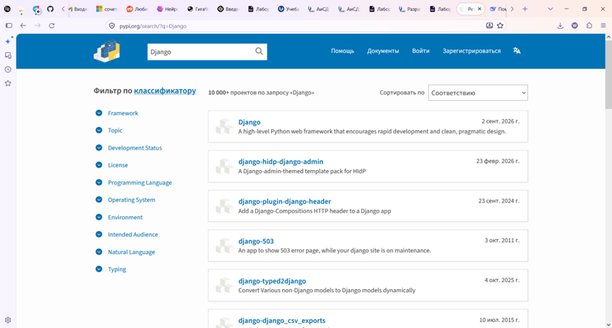 
<br> <em>Рисунок 4 – Выбор версии фреймворка Django</em> 
</p>

Для установки достаточно выполнить команду в активированном виртуальном окружении (рис. 5):

```bash
pip install django
```

<p align="center"> 
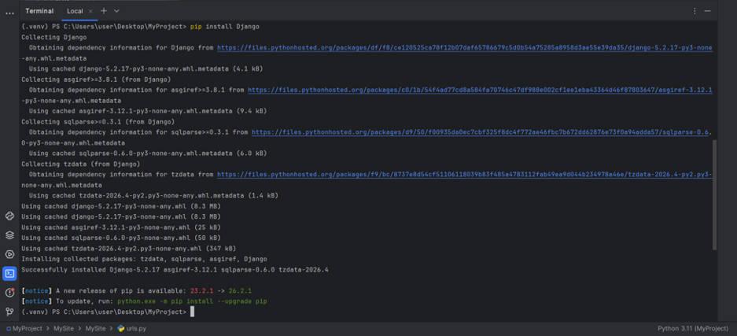 
<br> <em>Рисунок 5 – Установка фреймворка Django через команду pip install django</em> 
</p>

Менеджер пакетов `pip` автоматически обращается к `pypi.org`, находит последнюю стабильную версию Django и устанавливает её в виртуальное окружение.

После установки повторный вызов `pip list` показал наличие пакета Django (версия 5.2.17) (рис. 6).

<p align="center"> 
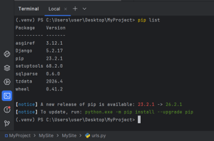 
<br> <em>Рисунок 6 – Проверка наличия списка пакетов после установки Django</em> 
</p>

### 3. Команда django-admin и список подкоманд

После установки Django становится доступной утилита командной строки `django-admin`. Для получения списка всех доступных подкоманд достаточно ввести её без аргументов (рис. 7):

```bash
django-admin
```

<p align="center"> 
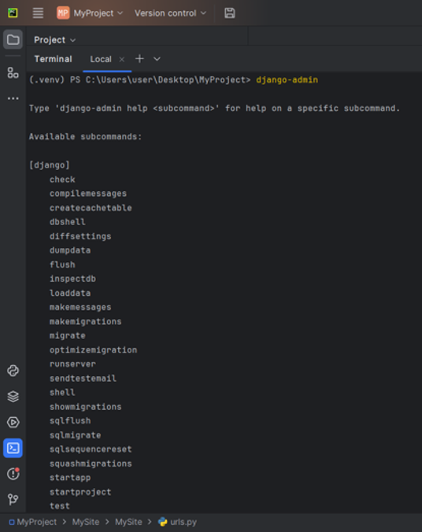 
<br> <em>Рисунок 7 – Команда django-admin для получения списка всех доступных подкоманд</em> 
</p>

В терминале отобразится список подкоманд, среди которых: `startproject` – создание нового проекта (рис. 8).

<p align="center"> 
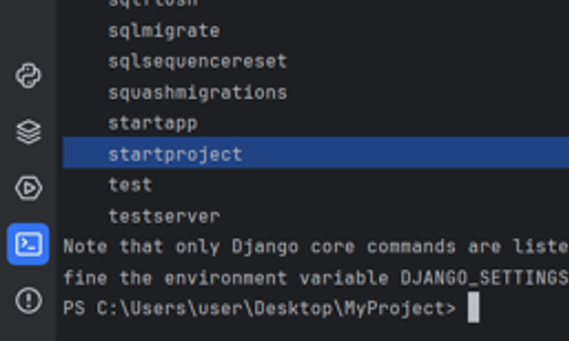 
<br> <em>Рисунок 8 – Подкоманда startproject для создания нового проекта</em> 
</p>

### 4. Создание проекта Django

Для создания самого Django-проекта использовалась подкоманда `startproject`. В терминале была выполнена команда (рис. 9):

```bash
django-admin startproject MySite
```

<p align="center"> 
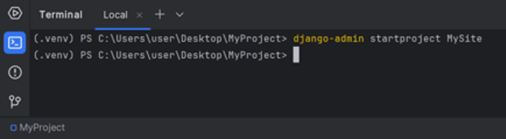 
<br> <em>Рисунок 9 – Команда django-admin startproject MySite для создания Django-проекта</em> 
</p>

В результате в дереве проекта появилась папка `MySite` (рис. 10).

<p align="center"> 
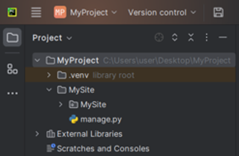 
<br> <em>Рисунок 10 – Папка проекта MySite</em> 
</p>

Внутри этой папки `MySite` создана одноимённая папка, в которой сформирован пакет, задающий конфигурацию проекта. О том, что это пакет, говорит наличие файла `__init__.py`. Одноимённую папку `MySite` называют пакетом конфигурации. В ней находятся файлы `settings.py`, `urls.py`, `wsgi.py`, `asgi.py` и `__init__.py`.

Проект готов, он ещё пустой, но его можно попробовать запустить. Чтобы запустить сервер, необходимо обратиться к файлу `manage.py`. Для этого нужно перейти в папку проекта с помощью команды (рис. 11):

```bash
cd MySite
```

<p align="center"> 
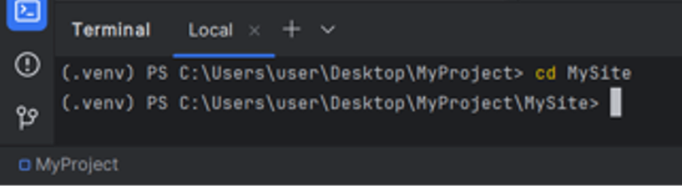 
<br> <em>Рисунок 11 – Переход в папку проекта с помощью команды cd MySite</em> 
</p>

Затем уже введена команда (рис. 12):

```bash
python manage.py runserver
```

<p align="center"> 
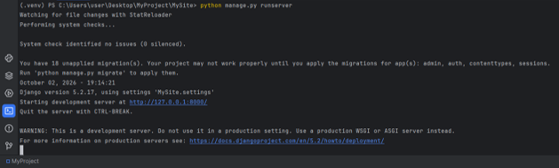 
<br> <em>Рисунок 12 – Команда python manage.py runserver запускает отладочный веб-сервер, который поставляется вместе с Django</em> 
</p>

По умолчанию отладочный веб-сервер запускается по адресу `http://127.0.0.1:8000/`.

При переходе по этому адресу запустился шаблон будущего сайта (рис. 13).

<p align="center"> 
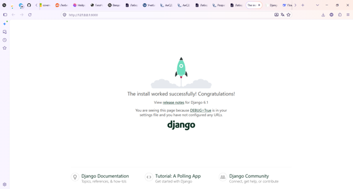 
<br> <em>Рисунок 13 – Шаблон будущего сайта по адресу http://127.0.0.1:8000/</em> 
</p>

В терминале при этом видны все входящие HTTP-запросы клиента (рис. 14).

<p align="center"> 
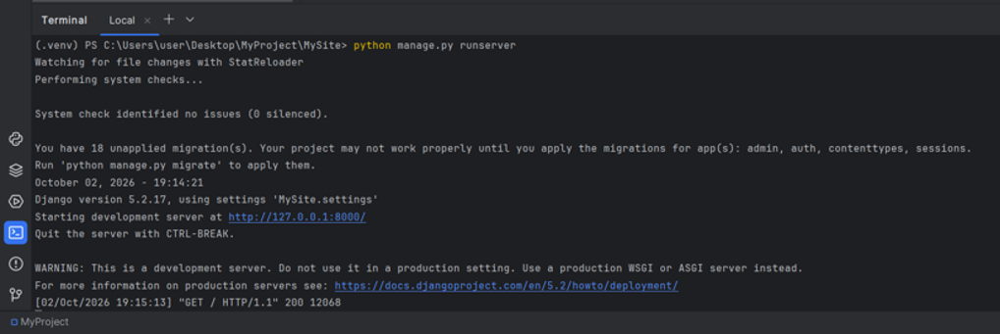 
<br> <em>Рисунок 14 – Отображение входящих HTTP-запросов клиента в терминале</em> 
</p>

Прелесть отладочного сервера в том, что он автоматически отслеживает изменения в существующем коде и перезапускается, подхватывая их. Однако он не отслеживает появление новых файлов. Для перезапуска сервера вручную используется комбинация клавиш `Ctrl+C`.

После перезапуска проекта появился новый файл `db.sqlite3` (рис. 15).

<p align="center"> 
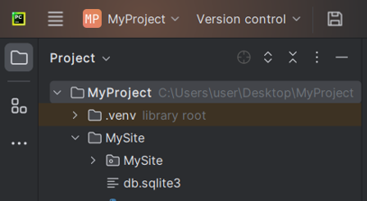 
<br> <em>Рисунок 15 – Файл базы данных sqlite3, которая поддерживается Django</em> 
</p>

### 5. Создание приложения

Проект пустой пока, всё, что мы видим – это пакет конфигурации проекта. Чтобы создать что-нибудь, необходимо создать хотя бы одно приложение.

Создадим новостной сайт. В командной строке терминала перейти в папку `MySite`, где находится `manage.py`, и ввести команду:

```bash
cd MySite
```

Затем выполнить команду создания приложения (рис. 16):

```bash
python manage.py startapp news
```

*(где `news` — это имя создаваемого приложения)*

<p align="center"> 
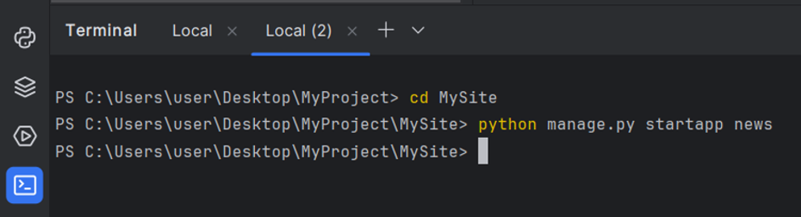 
<br> <em>Рисунок 16 – Выполнение команды python manage.py startapp news для создания приложения</em> 
</p>

В дереве проекта появилась папка `news` со стандартным набором файлов.

### 6. Регистрация приложения в настройках проекта

После создания приложения, чтобы Django корректно работал, приложение необходимо зарегистрировать. Регистрация выполняется в конфигурации проекта – в файле `settings.py`. В этом файле хранятся всевозможные настройки проекта. Регистрация производится в разделе `INSTALLED_APPS`. В конец списка была добавлена строка (рис. 17):

```python
'news.apps.NewsConfig',
```

<p align="center"> 
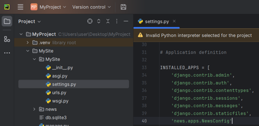 
<br> <em>Рисунок 17 – Регистрация приложения в файле settings.py в разделе INSTALLED_APPS</em> 
</p>

### 7. Создание контроллера (view)

Для создания контроллеров используется файл `views.py`. В этом файле описываются функции, которые обрабатывают запросы клиента и возвращают ответ.

Написан первый контроллер (функция), с названием `index`. На вход эта функция принимает обязательный аргумент – экземпляр класса `HttpRequest`, и называется он `request`. В нём хранятся данные о полученном запросе, о его клиенте, его браузере, хранятся куки, сессии и т.д. Когда мы получили запрос, то нам нужно вернуть какой-то ответ. Возвращать будем HTTP-ответ, который нам позволит сформировать класс `HttpResponse`. Его необходимо импортировать:

```python
from django.http import HttpResponse
```

Возвращаем его же, и в качестве аргумента передадим строку. В итоге код в файле `news/views.py` выглядит так (рис. 18).

```python
from django.shortcuts import render
from django.http import HttpResponse

def index(request):
    print(request)
    return HttpResponse('Hello world')
```

<p align="center"> 
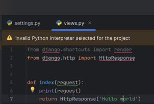 
<br> <em>Рисунок 18 – Создание первого контроллера (функции), с названием index</em> 
</p>

### 8. Настройка маршрутизации

Изначально, если попытаться набрать в адресной строке браузера адрес нашего приложения `news`, мы получим ошибку, поскольку маршрутизатор не знает такой адрес. Появится страница `Page not found (404)` (рис. 19).

<p align="center"> 
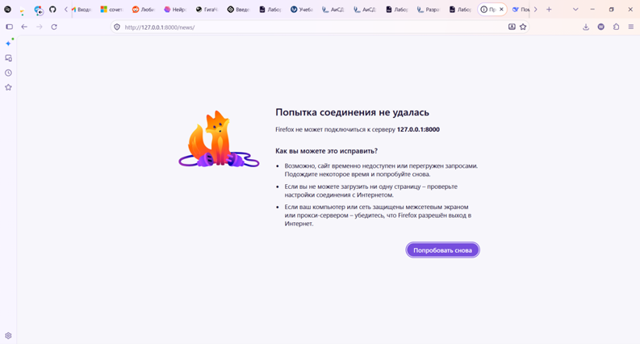 
<br> <em>Рисунок 19 – Ошибка подключения при попытке открыть страницу до запуска сервера</em> 
</p>

Django должен понимать, что при запросе того или иного адреса он должен обратиться к данному приложению, именно к данному контроллеру-функции. Здесь на помощь приходит маршрутизатор, который принимает первичный запрос клиента и сравнивает его со списками записанных маршрутов и адресов, и говорит, есть ли у него такой адрес или нет. Если есть, то он вызывает этот адрес и говорит клиенту, куда ему надо отправиться.

Список адресов находится в пакете конфигурации в файле `urls.py`. Здесь уже есть один адрес – админка (рис. 20).

<p align="center"> 
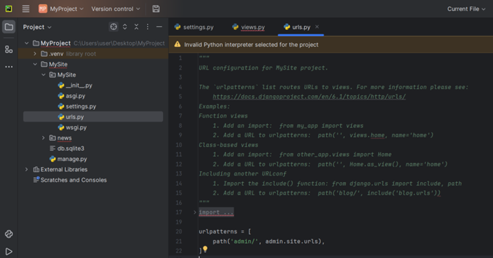 
<br> <em>Рисунок 20 – Записанный адрес админки в пакете конфигурации в файле urls.py</em> 
</p>

Если мы в адресной строке браузера допишем `admin` (`http://127.0.0.1:8000/admin`), то получим страницу входа в админку (рис. 21).

<p align="center"> 
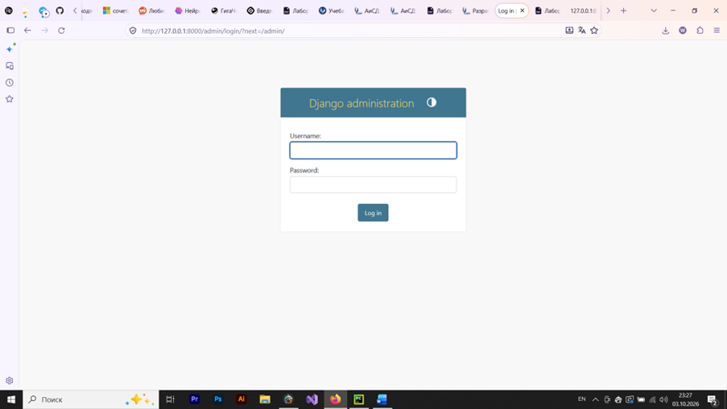 
<br> <em>Рисунок 21 – Страница входа в админку по адресу http://127.0.0.1:8000/admin</em> 
</p>

Для того чтобы прописать маршрутизатору путь, необходимо импортировать функцию `index` контроллера `views`. При этом красным цветом подсвечиваются ошибки. Это означает, что PyCharm не знает такого пути, потому что корневой директорией для нашего проекта является верхняя папка `MySite`, в которой ищется папка `views` и не находит её. Но эта папка есть во вложенной папке `MySite`, и поэтому эту папку надо указать как корневую для нашего проекта.

Для этого правой кнопкой мыши по папке `MySite` нужно щёлкнуть и выбрать `Mark Directory as` – `Sources Root` (рис. 22). После этого PyCharm будет считать эту папку корневой, и импорты будут находиться корректно.

<p align="center"> 
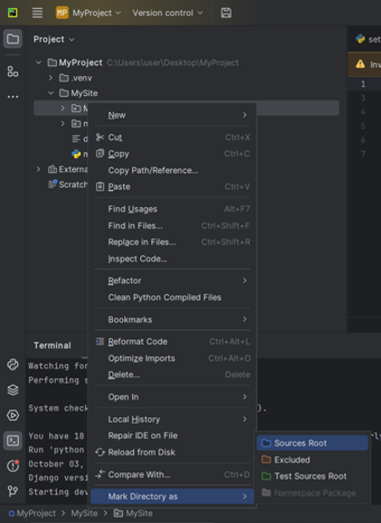 
<br> <em>Рисунок 22 – Указание папки MySite как корневой для нашего проекта</em> 
</p>

Мы импортировали нашу функцию `index` из модуля `news` в модуль `views`. Теперь можем вызвать функцию `path` – с помощью этой функции мы можем указать новый маршрут. Таких маршрутов может быть много. Но нас пока интересует один. Маршрутизатор, получив этот адрес, проходит по списку маршрутов и ищет совпадения. Первое найденное совпадение его устраивает, и он вызывает нужную функцию. В данном случае функция `index`, которую только что импортировали.

После импортирования вводим функцию `path`, которая указывает маршрут:

```python
path('news/', index),
```

Маршрутизатор отбрасывает весь путь, кроме имени нашего приложения `news`. В терминале можно увидеть выведенный нами запрос.

Если введём строку `print(dir(request))` и после обновления страницы `index` просмотрим в терминале все методы этого запроса (рис. 23), то увидим, что объект `request` содержит такие атрибуты, как `COOKIES`, `FILES`, `GET`, `POST`, `body`, `content_params`, `content_type`, `encoding`, `environ`, `get_full_path`, `method`, `path`, `session` и многие другие (рис. 24). Это демонстрирует, что в объекте `request` хранится вся информация о полученном запросе.

```python
def index(request):
    print(dir(request))
    return HttpResponse('Hello world')
```

<p align="center"> 
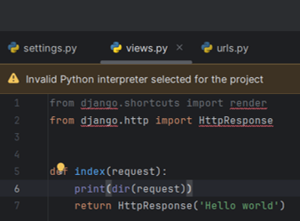 
<br> <em>Рисунок 23 – Строка print(dir(request)) для просмотра в терминале всех методов этого запроса</em> 
</p>

<p align="center"> 
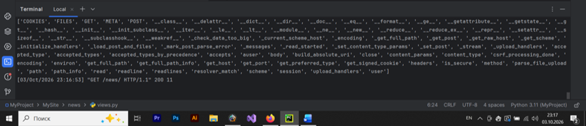 
<br> <em>Рисунок 24 – Атрибуты, которые содержит объект request</em> 
</p>

Создадим ещё одну функцию `test` (рис. 25) и тоже для неё зададим маршрут (рис. 26).

```python
def test(request):
    return HttpResponse('<h1>Тестовая страница</h1>')
```

<p align="center"> 
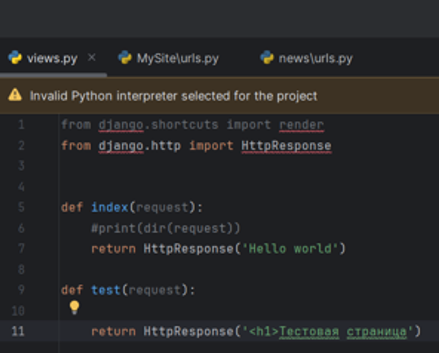 
<br> <em>Рисунок 25 – Функция test</em> 
</p>

```python
from news.views import index
from news.views import *

urlpatterns = [
    path('admin/', admin.site.urls),
    path('news/', index),
    path('test/', test),
]
```

<p align="center"> 
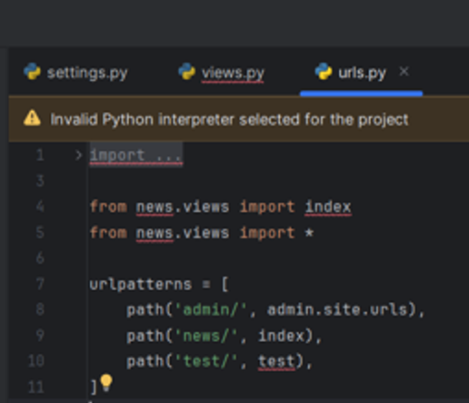 
<br> <em>Рисунок 26 – Задание маршрута для функции test</em> 
</p>

Посмотрим на нашу страницу: при переходе по адресу `http://127.0.0.1:8000/news/test/` отображается тестовая страница с заголовком Тестовая страница (рис. 27).

<p align="center"> 
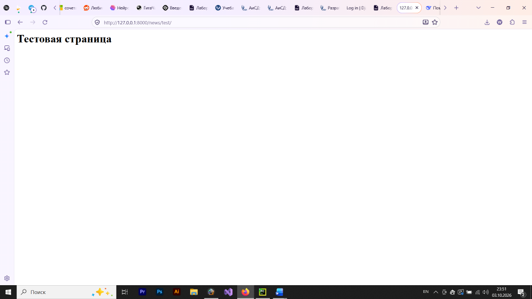 
<br> <em>Рисунок 27 – Отображение тестовой страницы с заголовком Тестовая страница по адресу http://127.0.0.1:8000/news/test/</em> 
</p>

Страница `test` должна быть вложенной для приложения `news`. Для этого нужно хранить все маршруты в нашем приложении `news`, что достигается путём импорта этих маршрутов. Для этого необходимо импортировать функцию `include` (рис. 28).

```python
from django.contrib import admin
from django.urls import path, include

from news.views import *

urlpatterns = [
    path('admin/', admin.site.urls),
    path('news/', include('news.urls')),
]
```

<p align="center"> 
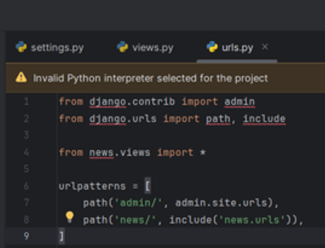 
<br> <em>Рисунок 28 – Импорт функции include для хранения всех маршрутов в приложении news</em> 
</p>

Файла (`news/urls.py`) в нашем приложении ещё нет, поэтому мы его должны создать. В папке `news` создаём новый файл `urls.py` (рис. 29).

<p align="center"> 
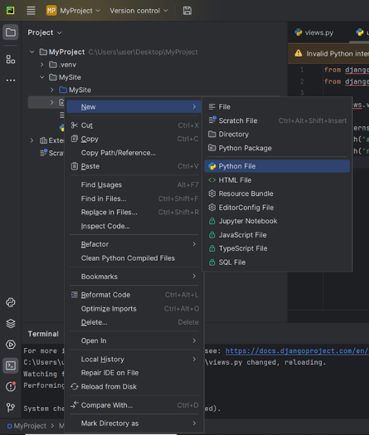 
<br> <em>Рисунок 29 – Создание файла news/urls.py в папке news</em> 
</p>

Импортируем в него функцию `path` (рис. 30).

```python
from django.urls import path

from .views import *
```

<p align="center"> 
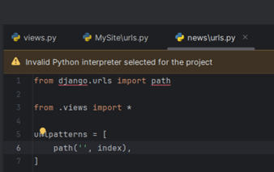 
<br> <em>Рисунок 30 – Импорт функции path в файл news/urls.py</em> 
</p>

Затем создаём переменную `urlpatterns` со списком адресов (рис. 31).

```python
from django.urls import path

from .views import *

urlpatterns = [
    path('', index),
    path('test/', test),
]
```

<p align="center"> 
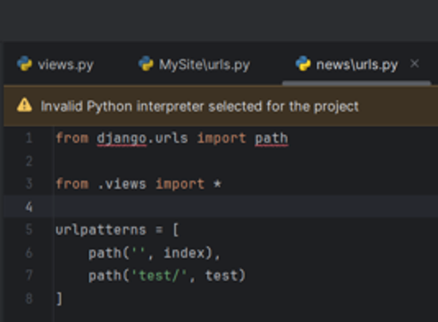 
<br> <em>Рисунок 31 – Создание переменной urlpatterns со списком адресов</em> 
</p>

<p align="center"> 
 
<br> <em>Рисунок 32 – Вложенная страница test для приложения news</em> 
</p>

---

## Вывод

В ходе лабораторной работы было настроено виртуальное окружение (вторым способом – автоматически средствами PyCharm), установлен Django и создан проект `MySite` с приложением `news`. Разработаны контроллеры `index` и `test` в файле `views.py`, возвращающие HTTP-ответы. Организованы маршруты: сначала в главном `urls.py`, затем с помощью функции `include` маршруты вынесены в `news/urls.py`, что сделало страницу `test` вложенной в приложение `news`. Работа сервера проверена: страницы `/news/` и `/news/test/` отображаются корректно, в терминале видны все запросы. Таким образом, виртуальное окружение настроено, контроллеры созданы, маршруты организованы.