# Отчет по лабораторной работе № 2

**Дисциплина:** Разработка web-приложений

**Выполнила:** студентка группы ПИЖ-б-о-25-1 (1), направление подготовки: 09.03.04 «Программная инженерия» Попова Виктория Романовна

**Проверила:** ассистент кафедры программной инженерии института информационных технологий и кибербезопасности Белик Ангелина Игоревна

**Тема:** Модели. CRUD.

*Ставрополь, 2026*

---

## Содержание

1. [Цель работы](#цель-работы)
2. [Теоретическое обоснование](#теоретическое-обоснование)
3. [Ход выполнения лабораторной работы](#ход-выполнения-лабораторной-работы)
4. [Выполнение индивидуального задания (вариант 1)](#выполнение-индивидуального-задания-вариант-1)
5. [Контрольные вопросы](#контрольные-вопросы)
6. [Вывод](#вывод)

---

## Цель работы

Разработка моделей, научиться проводить миграцию данных, работа с базой данных.

---

## Теоретическое обоснование

### 1. Модели в Django

Модель (Model) является ключевым компонентом архитектуры MTV (Model-Template-View). Она представляет собой слой данных, отвечающий за хранение, структурирование и предоставление информации. В Django каждая модель описывается в виде Python-класса, который наследуется от базового класса `django.db.models.Model`. При этом одна модель всегда соответствует одной таблице в базе данных, а её атрибуты – столбцам этой таблицы.

### 2. Поля моделей и их типы

Каждое поле в модели представлено экземпляром соответствующего класса `Field`, который определяет тип данных столбца в базе данных. Основные типы полей:

1. `CharField` – строка фиксированной длины (обязательно требует указания параметра `max_length`).
2. `TextField` – текстовое поле неограниченной длины (используется для больших объемов текста).
3. `DateTimeField` – дата и время.
4. `ImageField` – поле для загрузки изображений (требует установки сторонней библиотеки Pillow).
5. `BooleanField` – логическое поле (хранит значения True/False).

При описании полей могут использоваться следующие параметры:

- `blank=True` – разрешает оставлять поле пустым при валидации форм;
- `null=True` – разрешает хранение значения NULL в базе данных;
- `auto_now_add` – автоматически устанавливает текущую дату и время в момент создания объекта;
- `auto_now` – автоматически обновляет дату и время при каждом сохранении объекта;
- `upload_to` – указывает подкаталог (относительно `MEDIA_ROOT`) для сохранения загружаемых файлов.

### 3. Миграции

Миграции (migrations) – это механизм Django, позволяющий отслеживать изменения в структуре моделей и применять их к схеме базы данных. Они позволяют разработчику не писать SQL-запросы вручную. Основные команды для работы с миграциями:

1. `python manage.py makemigrations` – анализирует изменения в моделях и создает файлы миграций.
2. `python manage.py migrate` – применяет созданные миграции к базе данных (создает или изменяет таблицы).
3. `python manage.py sqlmigrate <app> <migration_name>` – выводит SQL-запрос, который будет выполнен при применении конкретной миграции.

### 4. ORM Django (Object-Relational Mapping)

ORM (Object-Relational Mapping) – это технология, позволяющая взаимодействовать с реляционной базой данных, используя объектно-ориентированный подход (через Python-код) вместо написания SQL-запросов. В Django ORM реализованы все основные операции CRUD:

1. **Create (Создание):** через конструктор `News(title='...')` с последующим вызовом `.save()`, либо через менеджер объектов `News.objects.create(title='...')`.
2. **Read (Чтение):**
   - `all()` – возвращает все записи модели;
   - `filter(kwargs)` – возвращает записи, удовлетворяющие условиям;
   - `get(kwargs)` – возвращает ровно одну запись (вызывает исключение, если записей нет или их несколько);
   - `exclude(kwargs)` – исключает записи, удовлетворяющие условиям.
3. **Update (Обновление):** изменение атрибутов полученного объекта и вызов метода `.save()`.
4. **Delete (Удаление):** вызов метода `delete()` у конкретного объекта.

### 5. Медиафайлы

Для корректной работы с загружаемыми пользователями файлами (например, изображениями) в файле `settings.py` необходимо определить две константы:

- `MEDIA_ROOT` – абсолютный путь к каталогу на сервере, где будут физически храниться файлы;
- `MEDIA_URL` – URL-префикс, по которому к этим файлам можно будет обращаться через браузер.

В режиме разработки (при `DEBUG = True`) необходимо добавить в корневой файл `urls.py` специальный маршрут для обслуживания медиафайлов с помощью функции `static()` из модуля `django.conf.urls.static`.

---

## Ход выполнения лабораторной работы

### 1. Подготовка менеджера баз данных

Модели в Django не хранят данные непосредственно в файлах проекта, они сохраняются в базе данных (БД).

В рамках данной работы используется портативная версия менеджера SQLiteStudio (в новых версиях программа называется Letos) (рис. 1). Портативная версия скачана в виде ZIP-архива (`letos-4.0.4-windows-x64.zip`), что позволяет использовать её без установки на компьютер. После распаковки архива был запущен исполняемый файл программы.

<p align="center"> 
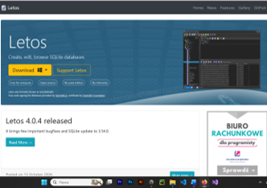 
<br> <em>Рисунок 1 – Сайт для скачивания портативной версии менеджера БД</em> 
</p>

### 2. Подключение базы данных

В программе Letos была добавлена база данных проекта. В поле «Файл» (File) указан путь к файлу `db.sqlite3`, расположенному в корне проекта. После успешной проверки соединения (Test connection) база данных подключена (рис. 2) и отображается в левой панели программы в виде списка таблиц.

<p align="center"> 
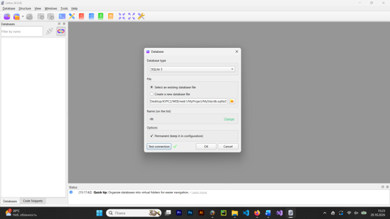 
<br> <em>Рисунок 2 – Подключение базы данных db.sqlite3 в менеджере Letos</em> 
</p>

Для описания структуры таблицы базы данных в Django используется файл `models.py`, расположенный внутри приложения `news` (рис. 3).

<p align="center"> 
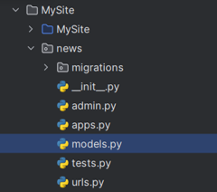 
<br> <em>Рисунок 3 – Расположение файла models.py в структуре приложения news</em> 
</p>

### 3. Создание модели данных

В файле `models.py` приложения `news` был создан собственный класс `News`, который является подклассом `django.db.models.Model`. Наследование от этого базового класса позволяет объекту получить все встроенные методы для работы с данными (ORM).

В созданном классе описаны атрибуты (свойства), которые являются обязательными. Каждый такой атрибут представляет собой экземпляр класса `Field` и соответствует определенному полю таблицы в базе данных. В нашем случае создана модель для таблицы новостей (`news`) (табл. 1).

**Таблица 1 – Описание полей модели News**

| Название поля | Атрибут | Назначение поля |
|---|---|---|
| title | Текстовое | Название статьи |
| content | Текстовое | Содержание статьи |
| create_at | Дата/Время | Дата и время создания статьи |
| updated | Дата/Время | Дата и время обновления статьи |
| photo | Тип картинки | Изображение |
| is_published | Логическое | Опубликована/Не опубликована статья |

<p align="center"> 
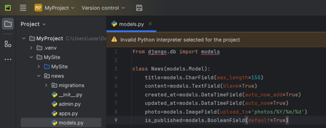 
<br> <em>Рисунок 4 – Описание модели News в файле models.py</em> 
</p>

Параметры полей:

- `auto_now_add=True` – автоматически устанавливает текущую дату и время в момент первого создания объекта.
- `auto_now=True` – автоматически обновляет дату и время при каждом сохранении объекта.
- `upload_to` – задает подкаталог для сохранения загружаемых файлов (медиафайлов). В данном случае используется форматирование `strftime()`: `%Y` (четырехзначный год), `%m` (двузначный месяц) и `%d` (двузначный день).
- `blank=True` – означает, что поле не является обязательным для заполнения (может оставаться пустым).

```python
from django.db import models

class News(models.Model):
    title = models.CharField(max_length=150)
    content = models.TextField(blank=True)
    created_at = models.DateTimeField(auto_now_add=True)
    updated_at = models.DateTimeField(auto_now=True)
    photo = models.ImageField(upload_to='photos/%Y/%m/%d')
    is_published = models.BooleanField(default=True)

    def __str__(self):
        return self.title
```

### 4. Создание миграций

После создания модели следующим этапом стало формирование файлов миграций.

Миграции – это механизм, с помощью которого Django переносит изменения, вносимые в модели, в схему базы данных. Они разработаны так, чтобы быть почти автоматическими, но требуют понимания того, когда их создавать и запускать.

В модели `News` используется поле `ImageField` (для загрузки изображений), для его работы требуется сторонняя библиотека Pillow. Поэтому предварительно в терминале была выполнена установка библиотеки командой (рис. 5):

```bash
python -m pip install Pillow
```

<p align="center"> 
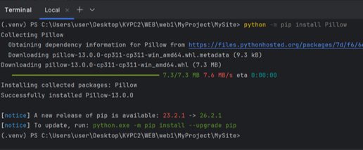 
<br> <em>Рисунок 5 – Установка библиотеки Pillow</em> 
</p>

Строка команды:

```bash
python manage.py makemigrations
```

анализирует текущее состояние моделей, отслеживает все внесенные изменения и автоматически создает для них файлы миграций (рис. 6).

В результате выполнения команды Django сгенерировал файл `0001_initial.py` (рис. 7) в папке `news/migrations`, который содержит инструкции по созданию модели `News` в базе данных.

<p align="center"> 
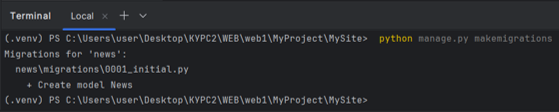 
<br> <em>Рисунок 6 – Выполнение команды makemigrations и успешное создание файла миграции 0001_initial.py</em> 
</p>

<p align="center"> 
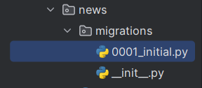 
<br> <em>Рисунок 7 – Сгенерированный файл миграции 0001_initial.py в папке migrations приложения news</em> 
</p>

В файле `0001_initial.py` отображается структура созданной миграции. Django автоматически добавил поле `id` (рис. 8).

<p align="center"> 
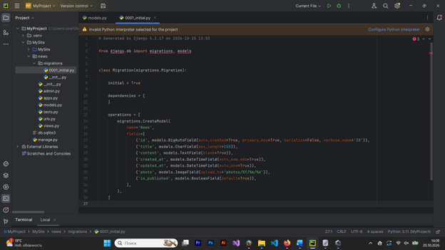 
<br> <em>Рисунок 8 – Содержимое файла 0001_initial.py с автоматически созданным полем id</em> 
</p>

Для просмотра SQL-запроса, который будет выполнен при создании таблицы в базе данных (рис. 9), в терминале была выполнена следующая команда:

```bash
python manage.py sqlmigrate news 0001
```

<p align="center"> 
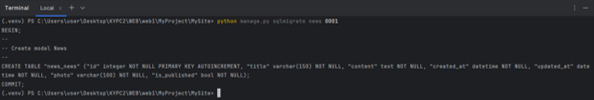 
<br> <em>Рисунок 9 – SQL-запрос, сгенерированный для создания таблицы news_news с помощью команды sqlmigrate</em> 
</p>

В файле `settings.py` пакета конфигурации отображается информация о текущей подключенной базе данных в виде словаря `DATABASES` (рис. 10).

<p align="center"> 
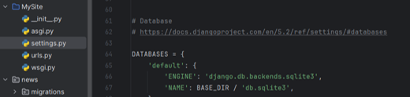 
<br> <em>Рисунок 10 – Словарь DATABASES в файле settings.py с настройками подключения к базе данных SQLite3</em> 
</p>

Как видно из конфигурации, в текущем проекте используется база данных SQLite3. В словаре применяется константа `BASE_DIR`, объявленная в этом же файле (рис. 11). Она указывает на корневую директорию проекта и определяет путь к файлу базы данных.

<p align="center"> 
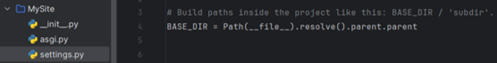 
<br> <em>Рисунок 11 – Определение константы BASE_DIR (корневого пути проекта) в файле settings.py</em> 
</p>

После успешного создания файла миграции необходимо применить изменения к базе данных. Для этого используется команда `migrate`. Данная команда считывает созданные файлы миграций и выполняет соответствующие SQL-запросы для создания или изменения таблиц в БД.

В терминале выполнена следующая команда (рис. 12):

```bash
python manage.py migrate
```

<p align="center"> 
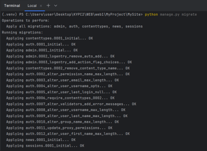 
<br> <em>Рисунок 12 – Выполнение команды python manage.py migrate и успешное применение всех миграций</em> 
</p>

Отметка ОК в конце каждой строки свидетельствует об успешном выполнении всех миграций, включая миграцию нашей модели, которая была применена последней. После обновления структуры базы данных в ней появились новые таблицы, среди которых присутствует таблица `news_news` (рис. 13).

<p align="center"> 
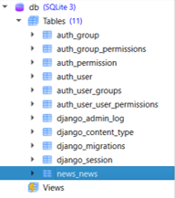 
<br> <em>Рисунок 13 – Список таблиц в базе данных после применения миграций</em> 
</p>

При выборе таблицы `news_news` в дереве БД отображаются её поля, соответствующие атрибутам модели (рис. 14), а также SQL-запрос (рис. 15), использованный при её создании.

<p align="center"> 
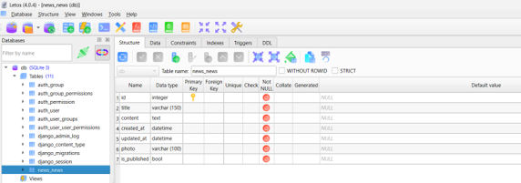 
<br> <em>Рисунок 14 – Структура таблицы news_news в менеджере Letos, соответствующая полям модели News</em> 
</p>

<p align="center"> 
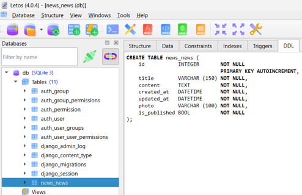 
<br> <em>Рисунок 15 – SQL-запрос (вкладка DDL), использованный для создания таблицы news_news в базе данных</em> 
</p>

Поле `photo` в базе данных имеет тип `varchar`, поэтому для физического сохранения изображений требуется настройка путей. С этой целью в конец файла `settings.py` были добавлены константы `MEDIA_ROOT` (путь к папке) и `MEDIA_URL` (URL-префикс) (рис. 16).

<p align="center"> 
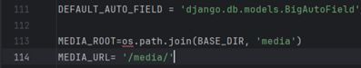 
<br> <em>Рисунок 16 – Добавление констант MEDIA_ROOT и MEDIA_URL в конце файла settings.py</em> 
</p>

### 5. Настройка маршрутизации для медиафайлов

Чтобы загруженные изображения корректно отображались на сайте, создан маршрут, указывающий на эти файлы. Для этого используется функция `static` из модуля Django. Данная функция создает маршрут, по которому маршрутизатор при запросе файлов передает управление специальному контроллеру Django, отдающему файл для просмотра.

Этот маршрут необходим только в отладочном режиме (при разработке сайта). При развертывании на реальном сервере он не используется, так как файлы будут обслуживаться самим веб-сервером.

В файле `settings.py` логическая константа `DEBUG` имеет значение `True`, что означает, что ведется разработка. После окончания разработки значение `True` необходимо заменить на `False`.

Для реализации маршрута был открыт корневой файл `urls.py`. Опираясь на константу `DEBUG`, было добавлено условие, обращающееся к модулю `settings` для указания пути к медиафайлам. При этом потребовалось подключить модуль `settings` (рис. 17).

<p align="center"> 
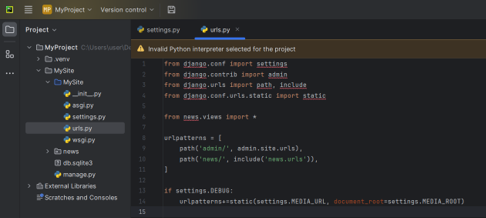 
<br> <em>Рисунок 17 – Добавление маршрута для обслуживания медиафайлов в отладочном режиме в файле urls.py</em> 
</p>

Созданный маршрут предназначен для получения медиафайлов. Для заполнения базы данных, созданной на предыдущем этапе, добавление записей производится через панель администратора (рис. 18).

<p align="center"> 
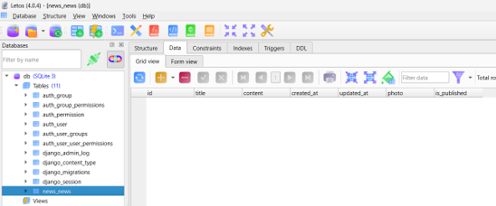 
<br> <em>Рисунок 18 – Просмотр таблицы news_news в режиме данных</em> 
</p>

### 6. Работа с ORM Django через интерактивную консоль

Для полноценной работы с базой данных через панель администратора необходимо создать суперпользователя, который обладает всеми правами. На данном этапе были добавлены и обработаны данные напрямую из консоли Django, чтобы ознакомиться с API для работы с моделями и механизмом ORM.

Консоль Django представляет собой интерактивную консоль Python, в которой можно писать и выполнять код, но с уже подключенным контекстом проекта (настройками и моделями).

Для её запуска необходимо выполнить команду `shell` через обращение к утилите `manage.py`:

```bash
python manage.py shell
```

В результате выполнения команды в терминале активируется интерактивная консоль, в которой доступен весь функционал Python и Django для тестирования модели (рис. 19).

<p align="center"> 
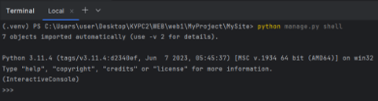 
<br> <em>Рисунок 19 – Запуск интерактивной консоли Django</em> 
</p>

В результате ввода команды была активирована интерактивная консоль `InteractiveConsole`. Для работы с моделью необходимо импортировать её из приложения, в котором она находится (рис. 20). Наша модель располагается в приложении `news`. Следует обратить внимание на регистр: имена моделей принято записывать с заглавной буквы.

<p align="center"> 
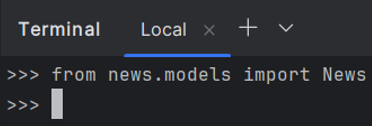 
<br> <em>Рисунок 20 – Импорт модели News в интерактивной консоли Django</em> 
</p>

При создании записи через консоль в конструктор модели `News` передаются значения полей:

```python
News(title='Новость 1', content='Контент новости 1')
```

(рис. 21).

<p align="center"> 
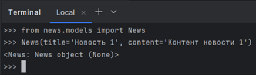 
<br> <em>Рисунок 21 – Создание экземпляра модели News через интерактивную консоль</em> 
</p>

В результате получаем `<News: News object (None)>`. Если обновить таблицу в БД, данных там не будет. Это связано с тем, что модели в Django являются «ленивыми»: SQL-запрос формируется, но не выполняется до момента явного вызова. Для сохранения данных в таблицу используется метод `save()`.

Чтобы сохранить созданный объект, присвоим результат предыдущего выражения переменной `news1` с помощью псевдопеременной `_`, которая хранит последний результат в консоли: `news1 = _` (рис. 22).

<p align="center"> 
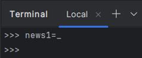 
<br> <em>Рисунок 22 – Сохранение созданного объекта News в переменную news1 в консоли Django</em> 
</p>

Если вывести переменную `news1` (рис. 23), в ней будет храниться ранее созданный экземпляр модели.

<p align="center"> 
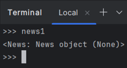 
<br> <em>Рисунок 23 – Проверка созданного объекта в переменной news1</em> 
</p>

Значение `None` указывает на отсутствие идентификатора (`id`) у объекта. Номер записи не существует до тех пор, пока она не будет сохранена в базу данных. Django автоматически присваивает `id` в момент сохранения (рис. 24).

<p align="center"> 
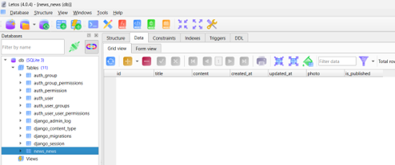 
<br> <em>Рисунок 24 – Таблица news_news в базе данных остается пустой, так как объект еще не сохранен в БД</em> 
</p>

Однако остальные свойства объекта уже содержат переданные значения и доступны для просмотра. Можно вывести атрибуты `news1.title` (рис. 25) или `news1.content` (рис. 26).

<p align="center"> 
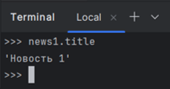 
<br> <em>Рисунок 25 – Вывод значения поля news1.title</em> 
</p>

<p align="center"> 
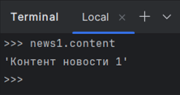 
<br> <em>Рисунок 26 – Вывод значения поля news1.content</em> 
</p>

При обращении к полю `id`, оно пустое, так как объект еще не сохранён в БД (рис. 27).

<p align="center"> 
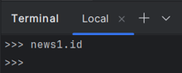 
<br> <em>Рисунок 27 – Проверка атрибута news1.id</em> 
</p>

Для сохранения записи в базе данных был использован метод `save()`. В консоли была выполнена команда:

```python
news1.save()
```

(рис. 28).

<p align="center"> 
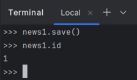 
<br> <em>Рисунок 28 – Сохранение объекта в базу данных с помощью метода save() и проверка автоматически присвоенного поля id</em> 
</p>

После вызова `save()` и проверки поля `id`, оно получило уникальное значение «1». Это означает, что Django успешно сохранил запись. При обновлении таблицы в Letos эта запись отобразится в базе данных (рис. 29).

<p align="center"> 
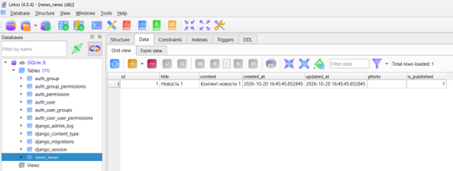 
<br> <em>Рисунок 29 – Отображение сохраненной записи в таблице news_news (id=1)</em> 
</p>

После сохранения поля `title` и `content` заполнились введенными данными, а `created_at` и `updated_at` – текущим временем. Логическое поле `is_published` получило значение 1 (признак публикации), а поле `photo` осталось пустым.

Для просмотра выполненных SQL-запросов необходимо импортировать `connection` из модуля `django.db` и обратиться к его свойству `queries` (рис. 30):

```python
from django.db import connection
connection.queries
```

<p align="center"> 
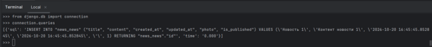 
<br> <em>Рисунок 30 – Просмотр выполненных SQL-запросов с помощью свойства connection.queries</em> 
</p>

В результате был получен список словарей с двумя ключами: `sql` – текст выполненного запроса и `time` – время, затраченное на его выполнение. Также стоит отметить, что у сохраненного объекта появилось свойство `pk` (primary key), значение которого совпадает со свойством `id` (рис. 31).

<p align="center"> 
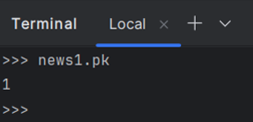 
<br> <em>Рисунок 31 – Проверка свойства pk (первичного ключа) сохраненного объекта news1</em> 
</p>

В Django многие механизмы основаны на соглашениях. В частности, существует универсальное свойство `pk` (сокращение от primary key – первичный ключ), которое позволяет обращаться к идентификатору записи независимо от того, как именно называется само поле (`id`). Свойство `pk` всегда хранит ключевое значение записи.

Далее была создана и сохранена еще одна запись (рис. 32):

```python
news2 = News(title='Новость 2', content='Контент новости 2')
news2.save()
```

<p align="center"> 
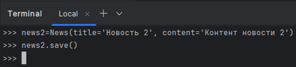 
<br> <em>Рисунок 32 – Добавление второй записи в таблицу news_news</em> 
</p>

<p align="center"> 
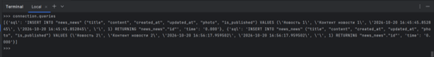 
<br> <em>Рисунок 33 – Список выполненных SQL-запросов после добавления записей в базу данных</em> 
</p>

Далее рассмотрен альтернативный способ создания записи: экземпляр модели создается без параметров, после чего значения его атрибутов заполняются отдельно (рис. 34).

<p align="center"> 
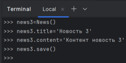 
<br> <em>Рисунок 34 – Альтернативный способ создания записи: вызов конструктора News() без параметров с последующим заполнением полей и сохранением</em> 
</p>

<p align="center"> 
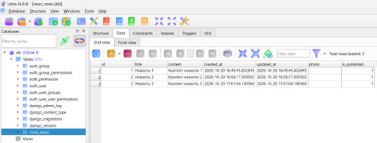 
<br> <em>Рисунок 35 – Таблица news_news после добавления записей (id=1, 2, 3)</em> 
</p>

После обновления в таблице отобразились три записи. Далее рассмотрен третий способ создания записи с помощью атрибута `objects`. Этот атрибут представляет собой менеджер, который позволяет сохранять и извлекать записи модели. При использовании метода `create()` объект сохраняется автоматически, и вызывать `save()` не требуется (рис. 36):

```python
news4 = News.objects.create(title='Новость 4', content='Контент новости 4')
```

<p align="center"> 
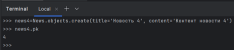 
<br> <em>Рисунок 36 – Использование метода create() для автоматического сохранения объекта в базе данных</em> 
</p>

<p align="center"> 
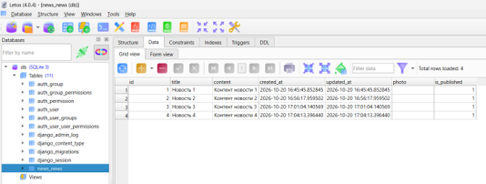 
<br> <em>Рисунок 37 – Таблица news_news после добавления четвертой записи с помощью метода News.objects.create()</em> 
</p>

Метод `create()` не только создает, но и сразу возвращает созданный объект. Для проверки этого была создана еще одна запись. В консоли была выполнена следующая команда:

```python
News.objects.create(title='Новость 5', content='Контент новости 5')
```

После нажатия Enter консоль вывела `<News: News object (5)>`, что подтверждает возврат экземпляра модели (рис. 38).

<p align="center"> 
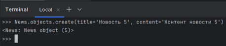 
<br> <em>Рисунок 38 – Автоматическое сохранение и возврат объекта при использовании метода create()</em> 
</p>

### 7. Операция чтения данных (Read)

Как было показано ранее, метод `create()` возвращает сохраненный объект со значением `id` равным 5 (а не `None`). Этим была завершена операция создания (Create) технологии CRUD.

Далее была рассмотрена операция чтения данных (Read), которая является одной из наиболее частых операций при работе с базами данных. Для получения всех записей из таблицы используется метод `all()`. Он вызывается через менеджер `objects` и возвращает набор записей, являющийся экземпляром класса `QuerySet`.

В интерактивной консоли `InteractiveConsole` была выполнена следующая команда:

```python
News.objects.all()
```

В результате модель вернула `QuerySet`, содержащий все наши записи в виде списка объектов (рис. 39).

<p align="center"> 
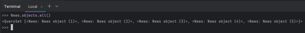 
<br> <em>Рисунок 39 – Получение всех записей модели News с помощью метода all() в консоли Django (вывод в виде QuerySet)</em> 
</p>

В таком формате Django выводит имя объекта и его `id`. Для того чтобы отображать значения полей, используется метод, возвращающий строковое представление объекта. Этот метод был описан в файле `models.py` (рис. 40).

<p align="center"> 
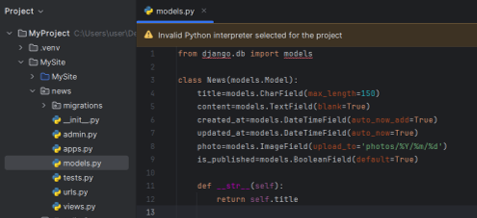 
<br> <em>Рисунок 40 – Добавление метода __str__ в модель News (файл models.py) для корректного строкового представления объекта</em> 
</p>

После добавления метода `__str__()` при распечатке объектов отображается их строковое представление (название новости). Для применения изменений консоль была перезапущена с помощью команды `exit()` (рис. 41).

<p align="center"> 
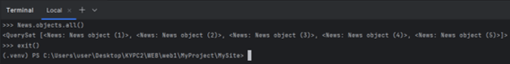 
<br> <em>Рисунок 41 – Выполнение запроса News.objects.all() и выход из консоли</em> 
</p>

Для применения изменений консоль была запущена заново командой `python manage.py shell`. После перезапуска модель была повторно импортирована (`from news.models import News`), и выполнен запрос `News.objects.all()` (рис. 42).

<p align="center"> 
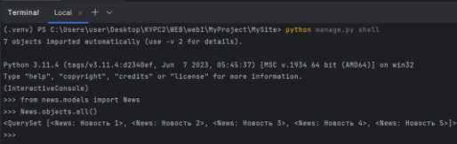 
<br> <em>Рисунок 42 – Результат выполнения команды News.objects.all() после добавления метода __str__</em> 
</p>

В консоли отобразились записи с названиями новостей. Поскольку был получен набор значений, его можно обработать в цикле. Для этого сохраним этот набор в переменную `news` с помощью псевдопеременной `_` (рис. 43):

```python
news = _
```

<p align="center"> 
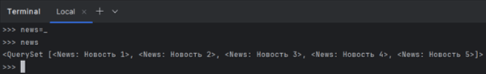 
<br> <em>Рисунок 43 – Сохранение полученного набора QuerySet в переменную news и её вывод в консоли</em> 
</p>

Например, для вывода списка новостей с признаком публикации использовался цикл (рис. 44):

```python
for item in news:
    print(item.title, item.is_published)
```

<p align="center"> 
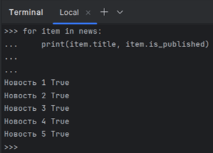 
<br> <em>Рисунок 44 – Вывод списка новостей и их статуса публикации с помощью цикла for</em> 
</p>

Если нужно получить не весь список, а записи, соответствующие определенным критериям, используется метод `filter()`.

Перед его использованием в базу данных были предварительно добавлены две записи с одинаковыми заголовками, но разным содержимым (рис. 45). После этого база данных была обновлена (рис. 46).

<p align="center"> 
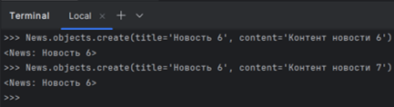 
<br> <em>Рисунок 45 – Создание двух записей с одинаковыми заголовками, но разным контентом, для последующей проверки метода filter()</em> 
</p>

<p align="center"> 
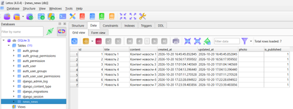 
<br> <em>Рисунок 46 – БД в Letos после добавления записей с одинаковым названием</em> 
</p>

Далее с помощью метода `filter()` были отфильтрованы и выведены записи с названием «Новость 6» (рис. 47).

<p align="center"> 
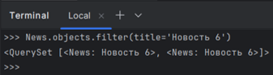 
<br> <em>Рисунок 47 – Фильтрация записей по названию с помощью метода filter()</em> 
</p>

`QuerySet` содержал две нужные записи. Для получения только одной используется метод `get()`, который применяется для поиска по первичному ключу (`id` или `pk`) (рис. 48):

```python
News.objects.get(pk=5)
```

<p align="center"> 
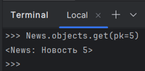 
<br> <em>Рисунок 48 – Получение одной записи с помощью метода get() по первичному ключу (pk=5)</em> 
</p>

Далее рассмотрена операция обновления данных. Для изменения записи её необходимо сначала извлечь из БД. Была получена запись с `id=7`, переименовано название новости (рис. 49), а затем изменения сохранены в базу данных (рис. 50).

<p align="center"> 
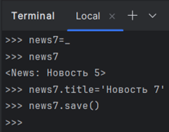 
<br> <em>Рисунок 49 – Операция обновления данных</em> 
</p>

<p align="center"> 
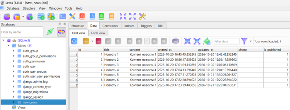 
<br> <em>Рисунок 50 – БД после переименования записи</em> 
</p>

Далее рассмотрен процесс удаления записи с помощью метода `delete()`. В качестве примера была удалена запись с идентификатором `id=7` (рис. 51).

<p align="center"> 
 
<br> <em>Рисунок 51 – Удаление записи с идентификатором id=7 с помощью метода delete()</em> 
</p>

<p align="center"> 
 
<br> <em>Рисунок 52 – БД после операции Delete</em> 
</p>

После обновления базы данных удаленная запись отсутствует. Далее рассмотрен метод `exclude()` для исключения ненужных записей из выборки.

Пример использования (рис. 53):

```python
News.objects.exclude(title='Новость 4')
```

<p align="center"> 
 
<br> <em>Рисунок 53 – Метод exclude() для исключения записей с заголовком «Новость 4» из результирующего набора</em> 
</p>

---

## Выполнение индивидуального задания (вариант 1)

Вариант предполагает создание модели, выполнение миграций, наполнение БД через консоль Django (`shell`) и проверку работы CRUD-операций.

**Общее задание:** создать проект и приложение в соответствии с темой варианта. Для общего задания использовать лабораторную работу 1.

**Вариант 1. Блог**

1. Модель: `Post` (поля: `title`, `content`, `author`, `created_at`, `is_published`).
2. Добавить поле `views_count` (целое число, по умолчанию 0).
3. Написать метод `__str__`, возвращающий заголовок поста.
4. Вывести все посты, у которых `is_published=True`.

### 1. Создание нового приложения blog

В терминале PyCharm введена команда:

```bash
python manage.py startapp blog
```

(рис. 54).

<p align="center"> 
 
<br> <em>Рисунок 54 – Создание приложения blog с помощью команды startapp</em> 
</p>

В дереве проекта появилась новая папка `blog` (рис. 55).

<p align="center"> 
 
<br> <em>Рисунок 55 – Расположение нового приложения blog в проекте MySite</em> 
</p>

### 2. Регистрация приложения в настройках

В файл `MySite/settings.py` в список `INSTALLED_APPS` добавлена строка:

```python
'blog.apps.BlogConfig',
```

(рис. 56).

<p align="center"> 
 
<br> <em>Рисунок 56 – Регистрация приложения blog в файле settings.py в MySite</em> 
</p>

В файле `blog/models.py` создан класс `Post`, описывающий структуру таблицы для статей блога. В соответствии с заданием, помимо стандартных полей (`title`, `content`, `author`, `created_at`, `is_published`), добавлено целочисленное поле `views_count` (количество просмотров) со значением по умолчанию 0.

Реализован метод `__str__`, который возвращает заголовок поста (рис. 57). Это необходимо для того, чтобы при выводе объектов в консоли отображались читаемые названия статей, а не записи вида `<Post: Post object (1)>`.

```python
from django.db import models

class Post(models.Model):
    title = models.CharField(max_length=200)
    content = models.TextField()
    author = models.CharField(max_length=200)
    created_at = models.DateTimeField(auto_now_add=True)
    is_published = models.BooleanField(default=False)
    views_count = models.IntegerField(default=0)

    def __str__(self):
        return self.title
```

<p align="center"> 
 
<br> <em>Рисунок 57 – Описание модели Post в файле models.py</em> 
</p>

### 3. Выполнение миграций

Для переноса описанной структуры в БД были созданы и применены миграции. Сначала команда `makemigrations` проанализировала модель и создала файл миграции, а затем `migrate` применила изменения к БД SQLite3:

```bash
python manage.py makemigrations blog
python manage.py migrate
```

(рис. 58).

<p align="center"> 
 
<br> <em>Рисунок 58 – Создание и успешное применение миграций для приложения blog</em> 
</p>

В результате в БД была создана новая таблица `blog_post` (рис. 59).

<p align="center"> 
 
<br> <em>Рисунок 59 – Структура созданной таблицы blog_post в Letos, соответствующая полям модели Post</em> 
</p>

### 4. Наполнение базы данных и проверка CRUD-операций

Для проверки работы модели запущена интерактивная консоль Django:

```bash
python manage.py shell
```

(рис. 60).

<p align="center"> 
 
<br> <em>Рисунок 60 – Запуск интерактивной консоли Django для работы с моделью Post</em> 
</p>

Внутри консоли модель была импортирована (рис. 61).

<p align="center"> 
 
<br> <em>Рисунок 61 – Импорт модели Post в консоль</em> 
</p>

**1) Create.** С помощью метода `create()` были добавлены две тестовые записи: опубликованная и черновик – не опубликованная (рис. 62).

<p align="center"> 
 
<br> <em>Рисунок 62 – Создание записей модели Post для проверки операции Create</em> 
</p>

**2) Read.** Для вывода постов, у которых `is_published=True`, был использован метод `filter()`, который возвращает отфильтрованный `QuerySet` (рис. 63).

<p align="center"> 
 
<br> <em>Рисунок 63 – Использование метода filter() для выборки опубликованных записей модели Post</em> 
</p>

<p align="center"> 
 
<br> <em>Рисунок 64 – Результат выполнения операции Create: две новые записи в таблице blog_post</em> 
</p>

**3) Update.** Чтобы проверить изменение данных, значение поля `views_count` увеличено на 10, после вызван метод `save()` для сохранения изменений в БД (рис. 65), (рис. 66).

<p align="center"> 
 
<br> <em>Рисунок 65 – Обновление данных в консоли Django – демонстрация операции Update</em> 
</p>

<p align="center"> 
 
<br> <em>Рисунок 66 – Обновленная таблица blog_post после изменения поля views_count</em> 
</p>

**4) Delete.** Для проверки удаления был получен черновик и вызван метод `delete()` (рис. 67).

<p align="center"> 
 
<br> <em>Рисунок 67 – Удаление записи из базы данных – демонстрация операции Delete</em> 
</p>

В консоли введен метод `exit()`, чтобы выйти из нее.

Открыта программа Letos и обновлена база данных. В таблице `blog_post` появились две записи (рис. 68).

<p align="center"> 
 
<br> <em>Рисунок 68 – Итоговое состояние таблицы blog_post после выполнения операций CRUD</em> 
</p>

---

## Контрольные вопросы

### 1. Что такое модель в Django и для чего она используется?

Модель – это Python-класс, который наследуется от `django.db.models.Model`. Она используется как слой данных (буква «M» в архитектуре MTV) и представляет собой описание структуры одной таблицы в базе данных. С помощью моделей Django позволяет создавать, читать, обновлять и удалять записи в БД, используя Python-код, а не SQL-запросы.

### 2. Какие типы полей вы знаете? Приведите примеры.

Основные типы полей:

1. `CharField` – для коротких строк (обязательно требует `max_length`).
2. `TextField` – для длинного текста без ограничения длины.
3. `IntegerField` – для целых чисел.
4. `BooleanField` – для логических значений (`True`/`False`).
5. `DateTimeField` – для даты и времени.
6. `ImageField` – для загрузки изображений (требует библиотеку Pillow).

### 3. Чем отличаются параметры blank=True и null=True?

`blank=True` – это ограничение на уровне валидации форм (и панели админа). Оно разрешает оставлять поле пустым. В базе данных при этом может храниться пустая строка.

`null=True` – это ограничение на уровне базы данных. Оно разрешает записывать в столбец значение `NULL` (полное отсутствие данных). Обычно используется для числовых полей или дат, если значение необязательно.

### 4. Что такое миграции и зачем они нужны? Опишите основные команды для работы с ними.

Миграции – это механизм Django для отслеживания изменений в моделях (добавление полей, удаление таблиц и т.д.) и применения этих изменений к схеме базы данных.

Основные команды:

- `python manage.py makemigrations` – создает файлы миграций на основе изменений в коде моделей;
- `python manage.py migrate` – применяет созданные миграции к базе данных (создает/изменяет таблицы);
- `python manage.py sqlmigrate <app> <номер>` – показывает SQL-запрос, который будет выполнен.

### 5. Как создать суперпользователя для доступа к административной панели Django?

В терминале (при активированном виртуальном окружении) необходимо выполнить команду:

```bash
python manage.py createsuperuser
```

После этого система попросит ввести имя пользователя (Username), адрес электронной почты (Email) и пароль (Password). Созданный пользователь сможет зайти в админку по адресу `http://127.0.0.1:8000/admin/`.

### 6. Что такое ORM? Перечислите основные методы для выполнения операций CRUD.

ORM (Object-Relational Mapping) – это технология, которая связывает объектно-ориентированный код Python с реляционной базой данных, позволяя работать с таблицами как с обычными объектами.

Основные методы CRUD:

- **Create:** `Model.objects.create(...)` или `obj = Model(...); obj.save();`
- **Read:** `Model.objects.all()`, `filter()`, `get()`, `exclude()`;
- **Update:** изменить атрибуты полученного объекта и вызвать `obj.save()`;
- **Delete:** вызвать `obj.delete()`.

### 7. В чем разница между методами filter() и get()?

`filter()` возвращает `QuerySet` – набор объектов (даже если найдена только одна запись или ни одной). Если записей нет, он вернет пустой `QuerySet`.

`get()` возвращает ровно один объект. Если запись не найдена, возникает ошибка `DoesNotExist`. Если найдено несколько записей, возникает ошибка `MultipleObjectsReturned`.

### 8. Как настроить загрузку изображений (медиафайлов) в проекте Django?

В файле `settings.py` нужно задать две константы:

```python
MEDIA_URL = '/media/'
MEDIA_ROOT = BASE_DIR / 'media'
```

В главном файле `urls.py` добавить маршрут для обслуживания медиафайлов в режиме разработки:

```python
urlpatterns += static(settings.MEDIA_URL, document_root=settings.MEDIA_ROOT)
```

### 9. Для чего нужен метод __str__ в модели?

Метод `__str__` определяет строковое представление объекта. Он используется для удобства: когда Django выводит объект в консоли, в панели администратора или в логах, он показывает не безликое `<Model: Model object (1)>`, а то, что возвращает этот метод (например, название статьи).

### 10. Что произойдёт, если выполнить python manage.py makemigrations, но не выполнить migrate?

Django проанализирует модели и создаст файл миграции (`0001_initial.py`), в котором будут прописаны инструкции по изменению БД. Однако сама база данных не изменится. В ней не появятся новые таблицы или поля до тех пор, пока команда `migrate` не будет выполнена.

---

## Вывод

В ходе выполнения лабораторной работы была освоена разработка моделей Django: создана структура таблицы `News` с необходимыми типами полей.

Получены навыки проводить миграцию данных: с помощью команд `makemigrations` и `migrate` изменения в моделях были успешно перенесены в схему базы данных SQLite3.

Также была освоена работа с базой данных через ORM Django: в интерактивной консоли (`shell`) успешно выполнены все операции CRUD (создание, чтение, обновление и удаление записей), а результаты проверены через менеджер баз данных Letos.