# Отчет по лабораторной работе № 3

**Дисциплина:** Разработка web-приложений

**Выполнила:** студентка группы ПИЖ-б-о-25-1 (1), направление подготовки: 09.03.04 «Программная инженерия» Попова Виктория Романовна

**Проверила:** ассистент кафедры программной инженерии института информационных технологий и кибербезопасности Белик Ангелина Игоревна

**Тема:** Шаблоны. Админка Django

*Ставрополь, 2026*

---

## Содержание

1. [Цель работы](#цель-работы)
2. [Ход выполнения лабораторной работы](#ход-выполнения-лабораторной-работы)
3. [Вывод](#вывод)

---

## Цель работы

Освоить работу с системой шаблонов Django (для вывода данных из базы данных на веб-страницы) и изучить инструменты встроенной административной панели (админки) для управления содержимым сайта.

---

## Ход выполнения лабораторной работы

### 1. Вывод данных из модели в браузере без использования шаблонов

В начале работы для вывода данных, полученных ранее в консоли, в браузере был запущен сервер и открыта главная страница с приветствием «Hello world».

Для получения данных из модели был открыт файл `views.py` (контроллер), в который добавлен импорт модели `News` (рис. 1):

```python
from .models import News
```

<p align="center"> 
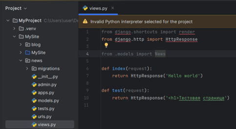 
<br> <em>Рисунок 1 – Импорт модели News в файл views.py приложения news</em> 
</p>

Далее в контроллере `index` была создана переменная `news`, в которую с помощью менеджера объектов и метода `all()` были получены все записи из базы данных (рис. 2):

```python
news = News.objects.all()
```

<p align="center"> 
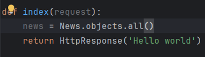 
<br> <em>Рисунок 2 – Получение всех записей из базы данных с помощью метода all() в контроллере index</em> 
</p>

Затем в следующей строке контроллера `index` был сформирован ответ, который отображается пользователю. С помощью цикла данные были объединены в HTML-строку с заголовком и списком новостей (рис. 3).

<p align="center"> 
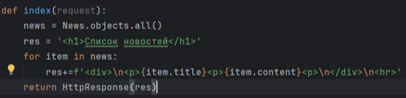 
<br> <em>Рисунок 3 – Формирование HTML-ответа с помощью цикла for в контроллере index</em> 
</p>

После обновления страницы в браузере отобразился список новостей, полученных из базы данных (рис. 4).

<p align="center"> 
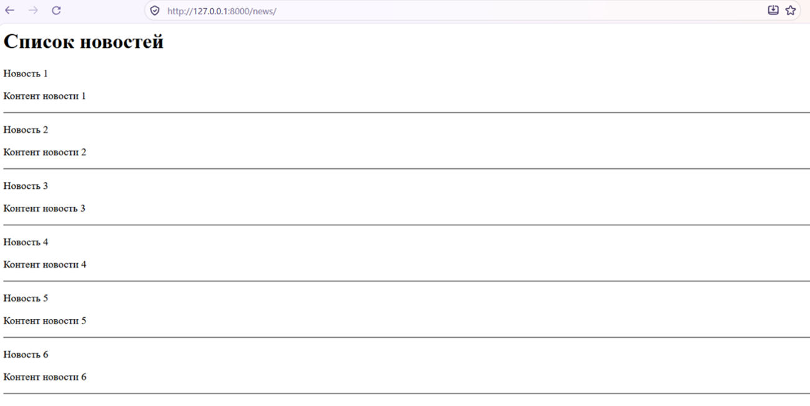 
<br> <em>Рисунок 4 – Результат вывода данных из модели в браузер без использования HTML-шаблонов</em> 
</p>

Затем был просмотрен исходный код страницы (рис. 5). Анализ кода показал, что в ответе отсутствуют стандартные теги `<html>`, `<head>` и `<body>` (рис. 6), что делает структуру страницы неполноценной и обосновывает необходимость перехода к использованию шаблонов.

<p align="center"> 
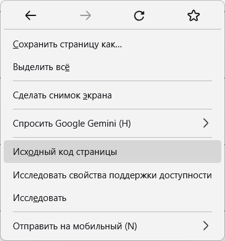 
<br> <em>Рисунок 5 – Открытие меню для просмотра исходного HTML-кода страницы</em> 
</p>

<p align="center"> 
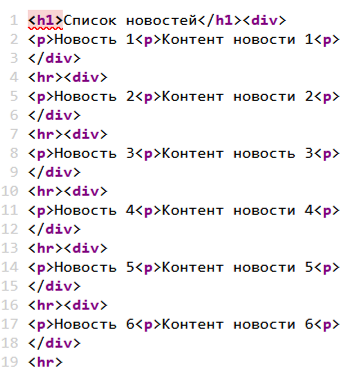 
<br> <em>Рисунок 6 – Исходный код страницы, демонстрирующий отсутствие стандартных тегов html, head и body</em> 
</p>

### 2. Создание и подключение шаблонов (Templates)

Шаблон – это обычный HTML-файл, который позволяет отделить логику приложения (Python-код) от визуального представления (HTML). Процесс наполнения шаблона данными из модели называется рендерингом.

Django работает с шаблонами с помощью встроенного шаблонизатора. Описание работы шаблонизатора было изучено в официальной документации Django (рис. 7), (рис. 8).

<p align="center"> 
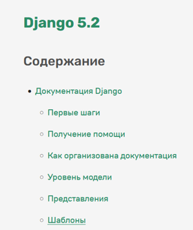 
<br> <em>Рисунок 7 – Оглавление официальной документации Django (раздел «Шаблоны»)</em> 
</p>

<p align="center"> 
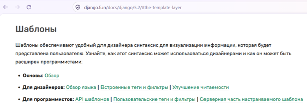 
<br> <em>Рисунок 8 – Изучение теоретической части о работе шаблонизатора Django</em> 
</p>

При работе с шаблонизатором используются три основных объекта: директивы (переменные), теги и фильтры. По умолчанию Django ищет шаблоны в папке `templates` внутри соответствующего приложения. Так как по умолчанию эта папка не создается, возникла необходимость создать её вручную (рис. 9), (рис. 10).

<p align="center"> 
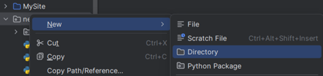 
<br> <em>Рисунок 9 – Выбор команды создания нового каталога (Directory) для хранения HTML-шаблонов</em> 
</p>

<p align="center"> 
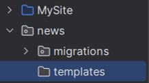 
<br> <em>Рисунок 10 – Расположение директории templates внутри приложения для хранения HTML-шаблонов</em> 
</p>

Django рекомендует внутри папки `templates` создавать подкаталог с именем, совпадающим с именем приложения (рис. 11). Это делается для создания пространства имен. При сборке приложения Django собирает все шаблоны в одном месте, и, если в разных приложениях будут файлы с одинаковыми именами, возникнет конфликт. Подкаталог с именем приложения помогает этого избежать.

<p align="center"> 
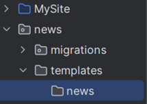 
<br> <em>Рисунок 11 – Создание подкаталога news внутри папки templates для формирования пространства имен</em> 
</p>

Далее в папке `templates/news` был создан HTML-файл шаблона `index.html` (по названию контроллера, который возвращает ответ) и заполнен базовой разметкой (рис. 12, 13).

<p align="center"> 
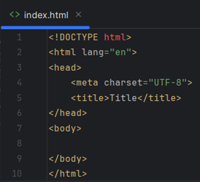 
<br> <em>Рисунок 12 – Созданный файл index.html с базовой HTML-разметкой</em> 
</p>

<p align="center"> 
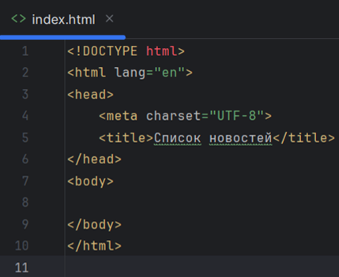 
<br> <em>Рисунок 13 – Отредактированный файл index.html с измененным заголовком страницы</em> 
</p>

Для подключения шаблона (проведения рендеринга) в файл `views.py` из модуля `django.shortcuts` была импортирована функция `render` (рис. 14).

<p align="center"> 
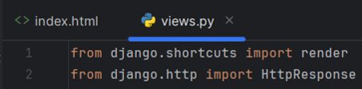 
<br> <em>Рисунок 14 – Импорт функции render из модуля django.shortcuts для подключения шаблонов</em> 
</p>

Контроллер `index` был изменен: теперь вместо `HttpResponse` он возвращает результат работы функции `render`. Функция принимает объект запроса (`request`), путь к шаблону и контекст – словарь с данными, которые необходимо передать в шаблон (рис. 15). В качестве контекста передавались список `news` и заголовок `title`.

<p align="center"> 
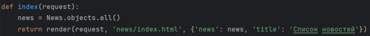 
<br> <em>Рисунок 15 – Измененный контроллер index, возвращающий функцию render с передачей контекста в шаблон</em> 
</p>

Для вывода переданных данных в шаблоне `index.html` были использованы директивы (переменные), которые заключаются в двойные фигурные скобки `{{ }}`. С их помощью были выведены заголовок и список новостей (рис. 16).

<p align="center"> 
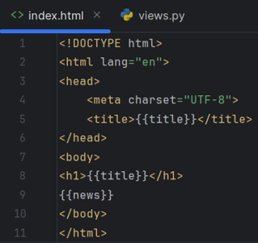 
<br> <em>Рисунок 16 – Использование директив {{ title }} и {{ news }} для вывода переданных данных в файле index.html</em> 
</p>

После обновления страницы в браузере данные отобразились уже внутри полноценной HTML-разметки (рис. 17).

<p align="center"> 
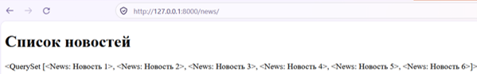 
<br> <em>Рисунок 17 – Результат вывода директив шаблонизатора до применения тегов цикла</em> 
</p>

### 3. Работа с фильтрами и настройка локализации

Как было замечено ранее, вывод данных без использования тегов шаблонизатора выглядел нечитабельно. Это было исправлено с помощью тегов, которые управляют генерированием вывода. Был использован тег `for`, организующий цикл по объектам. В шаблонизаторе Django теги записываются в конструкциях ``. В файл `index.html` был добавлен цикл для перебора новостей (рис. 18).

```html

    <div>
        <p>{{ item.title }}</p>
        <p>{{ item.content }}</p>
        <p>{{ item.created_at }}</p>
    </div>
    <hr>

```

<p align="center"> 
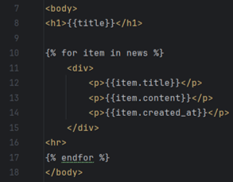 
<br> <em>Рисунок 18 – Использование тега  и директив {{ }} для итерации по списку новостей в шаблоне</em> 
</p>

После обновления страницы браузера список новостей отобразился в аккуратном, структурированном формате (рис. 19).

<p align="center"> 
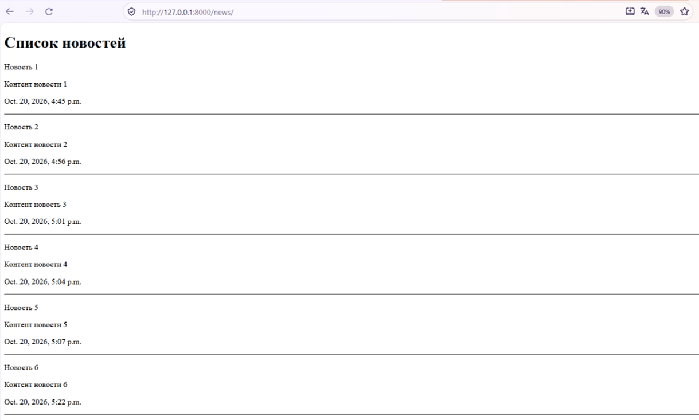 
<br> <em>Рисунок 19 – Отформатированный список новостей в браузере после применения тега цикла </em> 
</p>

Однако было замечено, что дата представлена в англоязычном формате, что может быть непонятно рядовому пользователю. Исправить это можно двумя способами.

Первый способ – обратиться к настройкам приложения в файле `settings.py`. Параметр `LANGUAGE_CODE` (рис. 20) был изменен с `'en-us'` на `'ru'` (рис. 21).

<p align="center"> 
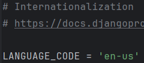 
<br> <em>Рисунок 20 – Исходная настройка LANGUAGE_CODE = 'en-us' в файле settings.py</em> 
</p>

<p align="center"> 
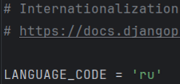 
<br> <em>Рисунок 21 – Изменение параметра LANGUAGE_CODE на 'ru' для локализации проекта на русский язык</em> 
</p>

Это означает, что все настройки локализации теперь отталкиваются от русского языка. После обновления страницы список новостей отобразился с датой в удобном для нас формате (рис. 22).

<p align="center"> 
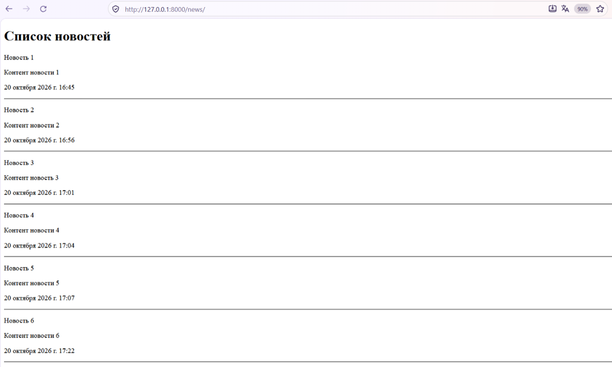 
<br> <em>Рисунок 22 – Список новостей с датами в русскоязычном формате после изменения настроек локализации</em> 
</p>

Второй способ (более гибкий) – использование фильтров. В файле шаблона к переменной даты был применен фильтр `date` с нужным форматом (рис. 23):

```html
<p>{{ item.created_at|date:"Y-m-d H:i:s" }}</p>
```

<p align="center"> 
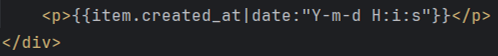 
<br> <em>Рисунок 23 – Использование встроенного фильтра date:"Y-m-d H:i:s" для вывода даты в заданном формате</em> 
</p>

После обновления страницы дата отобразилась в заданном формате (рис. 24).

<p align="center"> 
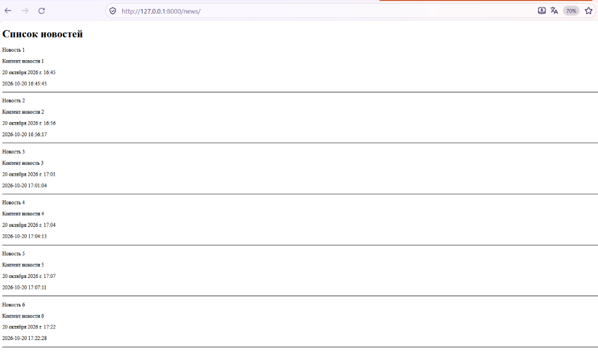 
<br> <em>Рисунок 24 – Отображение даты в заданном формате с помощью фильтра date</em> 
</p>

Ранее при возврате ответа через `render` контекст передавался напрямую. Если данных много, удобнее создать отдельную переменную-словарь, содержащую все передаваемые значения (рис. 25).

```python
def index(request):
    news = News.objects.all()
    context = {
        'news': news,
        'title': 'Список новостей'
    }
    return render(request, 'news/index.html', context)
```

<p align="center"> 
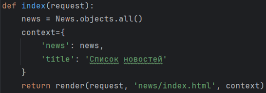 
<br> <em>Рисунок 25 – Создание отдельной переменной context (словаря) для передачи данных в шаблон</em> 
</p>

Кроме того, при вызове функции `render` можно использовать именованные аргументы (`template_name`, `context`), что делает код более прозрачным (рис. 26).

```python
return render(request, template_name='news/index.html', context=context)
```

<p align="center"> 
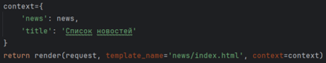 
<br> <em>Рисунок 26 – Использование именованных аргументов (template_name, context) в функции render для улучшения читаемости кода</em> 
</p>

Для того чтобы расположить новости по дате создания (от новых к старым), в контроллере `index` метод `all()` был заменен на метод `order_by('-created_at')`. Знак минус указывает на сортировку в обратном порядке (рис. 27).

```python
def index(request):
    news = News.objects.order_by('-created_at')
```

<p align="center"> 
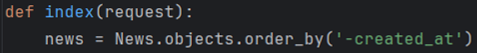 
<br> <em>Рисунок 27 – Сортировка новостей по дате создания в обратном порядке с помощью метода order_by('-created_at')</em> 
</p>

Таким образом, была получена готовая HTML-страница с выводом отсортированных данных модели (рис. 28).

<p align="center"> 
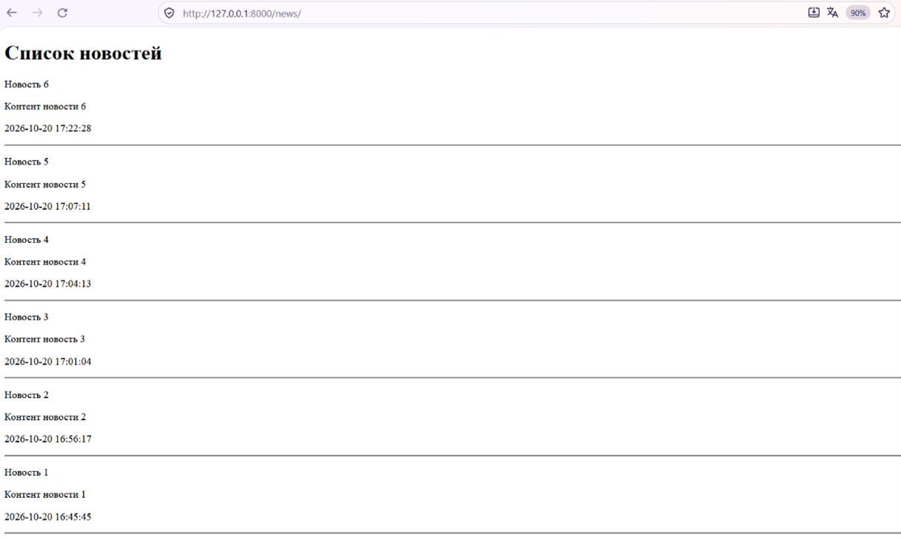 
<br> <em>Рисунок 28 – Итоговый список новостей в браузере с сортировкой по дате (от новых к старым) и отформатированным выводом времени</em> 
</p>

### 4. Создание суперпользователя и вход в админку

Для управления содержимым сайта в Django предусмотрена встроенная административная панель, которая доступна по умолчанию. Для перехода на стартовую страницу админки в браузере был открыт адрес `http://127.0.0.1:8000/admin`.

Для доступа к панели требуется авторизация (рис. 29).

<p align="center"> 
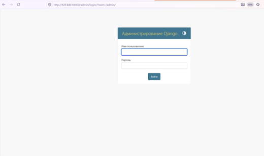 
<br> <em>Рисунок 29 – Стартовая страница входа в административную панель Django по адресу /admin/</em> 
</p>

Чтобы получить права администратора, было необходимо создать суперпользователя. Для создания суперпользователя в терминале (при активированном виртуальном окружении) была введена команда:

```bash
python manage.py createsuperuser
```

(рис. 30).

<p align="center"> 
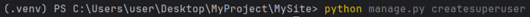 
<br> <em>Рисунок 30 – Ввод команды python manage.py createsuperuser в терминале для создания аккаунта администратора</em> 
</p>

После выполнения команды система последовательно запросила данные для новой учетной записи. В качестве имени пользователя было введено `admin`, а также адрес электронной почты (рис. 31).

<p align="center"> 
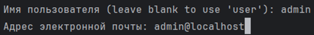 
<br> <em>Рисунок 31 – Заполнение данных учетной записи администратора в терминале</em> 
</p>

Далее потребовалось ввести пароль. Стоит отметить, что при вводе пароля его символы не отображаются в терминале в целях безопасности.

После подтверждения (ввод `y`) в консоли появилось сообщение об успешном создании суперпользователя: `Superuser created successfully` (рис. 32).

<p align="center"> 
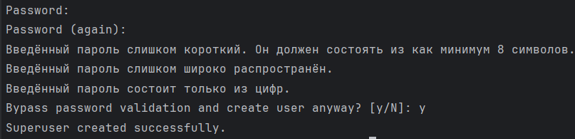 
<br> <em>Рисунок 32 – Обход валидации пароля (ввод y) и успешное создание суперпользователя (Superuser created successfully)</em> 
</p>

Используя созданные учетные данные, был выполнен вход в административную панель (рис. 33).

<p align="center"> 
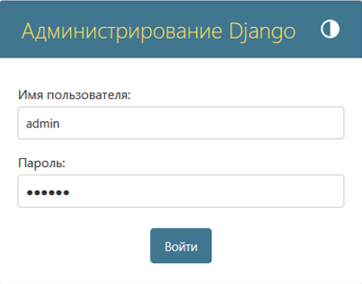 
<br> <em>Рисунок 33 – Заполнение формы входа в админку Django</em> 
</p>

В результате открылась главная страница администрирования сайта, на которой по умолчанию доступны разделы «Пользователи» и «Группы» (рис. 34).

<p align="center"> 
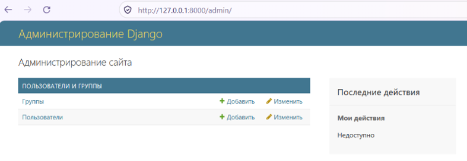 
<br> <em>Рисунок 34 – Главная страница административной панели Django после успешной авторизации</em> 
</p>

### 5. Регистрация модели и настройка отображения (Meta)

Изначально в административной панели отображались только стандартные разделы.

Для регистрации модели был открыт файл `admin.py` в приложении `news`. В него был добавлен импорт модели и строка регистрации с помощью метода `register()`:

```python
from .models import News

admin.site.register(News)
```

<p align="center"> 
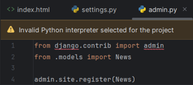 
<br> <em>Рисунок 35 – Добавление импорта модели и строки регистрации для отображения новостей в административной панели</em> 
</p>

После обновления страницы в списках появилось наше приложение. Стоит отметить, что Django автоматически добавляет букву «S» к названию зарегистрированного приложения, поэтому в меню оно отобразилось как `Newss` (рис. 36).

<p align="center"> 
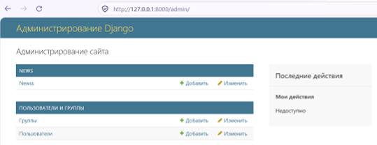 
<br> <em>Рисунок 36 – Отображение зарегистрированного приложения в списке администрирования сайта</em> 
</p>

При переходе в этот раздел открылся список всех наших новостей (рис. 37).

<p align="center"> 
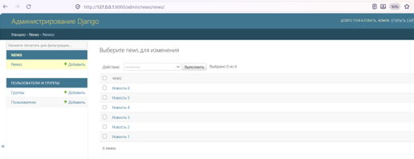 
<br> <em>Рисунок 37 – Отображение сохраненных записей и панели доступных действий в админке</em> 
</p>

В админке стали доступны действия по выбору записей (рис. 38), добавлению новой новости через специальную форму (рис. 39) и редактированию уже существующих записей (рис. 40).

<p align="center"> 
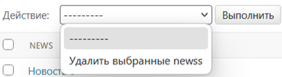 
<br> <em>Рисунок 38 – Выпадающее меню «Действие» с доступной опцией удаления выбранных записей</em> 
</p>

<p align="center"> 
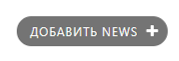 
<br> <em>Рисунок 39 – Кнопка «Добавить NEWS» для перехода к форме создания новой новости</em> 
</p>

<p align="center"> 
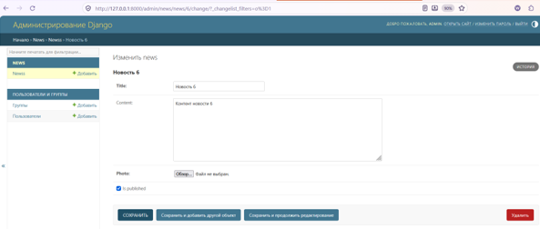 
<br> <em>Рисунок 40 – Интерфейс изменения новости «Новость 6» в админке</em> 
</p>

Для того чтобы сделать интерфейс админки более удобным и понятным, в файле `models.py` был создан специальный подкласс `Meta`. В нем был задан атрибут `verbose_name = 'Новость'`, который определяет название модели в единственном числе (рис. 41).

<p align="center"> 
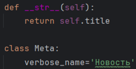 
<br> <em>Рисунок 41 – Создание подкласса Meta в модели News и добавление атрибута verbose_name для переименования модели в единственном числе</em> 
</p>

После обновления страницы заголовки в админке изменились на русскоязычные (рис. 42).

<p align="center"> 
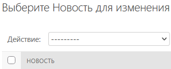 
<br> <em>Рисунок 42 – Отображение русскоязычного названия модели в заголовке страницы администрирования</em> 
</p>

Далее в подкласс `Meta` был добавлен атрибут `verbose_name_plural = 'Новости'`, отвечающий за название во множественном числе (рис. 43).

<p align="center"> 
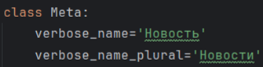 
<br> <em>Рисунок 43 – Добавление атрибута verbose_name_plural в класс Meta для отображения названия модели во множественном числе</em> 
</p>

<p align="center"> 
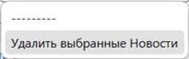 
<br> <em>Рисунок 44 – Название модели во множественном числе в интерфейсе админки</em> 
</p>

Также в классе `Meta` был настроен порядок сортировки записей по умолчанию с помощью атрибута `ordering = ['-created_at']`, (рис. 45). Важно отметить, что эта сортировка влияет не только на админку, но и на пользовательскую часть сайта. Благодаря этому, в контроллере `views.py` стало возможным убрать явное указание метода `order_by`, так как порядок теперь берется из самой модели (рис. 46).

<p align="center"> 
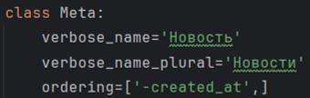 
<br> <em>Рисунок 45 – Настройка параметров модели News (названия и порядок сортировки) с помощью подкласса Meta</em> 
</p>

<p align="center"> 
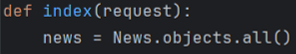 
<br> <em>Рисунок 46 – Удаление явной сортировки из файла views.py для оптимизации кода</em> 
</p>

Для окончательной русификации было решено изменить название самого приложения в меню админки с «NEWS» на «НОВОСТИ». Для этого была открыта конфигурация приложения в файле `apps.py`, где в классе `NewsConfig` был добавлен атрибут `verbose_name = 'Новости'` (рис. 47).

<p align="center"> 
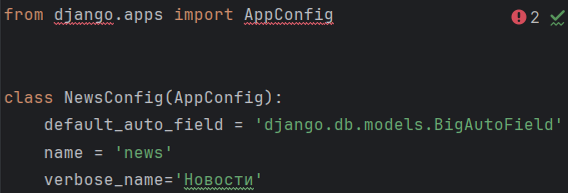 
<br> <em>Рисунок 47 – Добавление атрибута verbose_name в класс NewsConfig (файл apps.py) для изменения названия приложения в админке</em> 
</p>

После обновления страницы админки раздел стал называться на русском языке (рис. 48).

<p align="center"> 
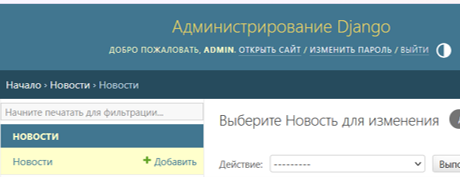 
<br> <em>Рисунок 48 – Отображение русифицированного названия приложения в левом меню и заголовке страницы</em> 
</p>

### 6. Настройка списка отображения в админке (Admin Model)

Следующим шагом стала кастомизация списка новостей в админке. Для этого в файле `admin.py` был создан специальный класс-редактор `NewsAdmin`, наследуемый от `admin.ModelAdmin`. В нём с помощью атрибута `list_display` был задан список полей, которые должны отображаться в виде колонок: `('id', 'title', 'created_at', 'updated_at', 'is_published')` (рис. 49).

<p align="center"> 
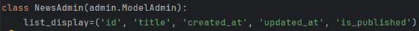 
<br> <em>Рисунок 49 – Создание класса NewsAdmin и настройка списка отображаемых полей в админке с помощью атрибута list_display</em> 
</p>

Чтобы настройки вступили в силу, класс `NewsAdmin` был передан вторым аргументом в метод регистрации модели. Важно соблюдать порядок: сначала создается настраивающий класс, а затем модель регистрируется вместе с ним (рис. 50).

```python
class NewsAdmin(admin.ModelAdmin):
    list_display = ('id', 'title', 'created_at', 'updated_at', 'is_published')

admin.site.register(News, NewsAdmin)
```

<p align="center"> 
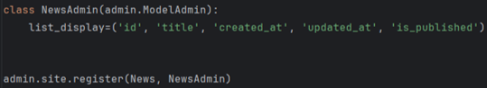 
<br> <em>Рисунок 50 – Регистрация модели News в административной панели с передачей настраивающего класса NewsAdmin</em> 
</p>

После обновления страницы админки колонки отобразились, но их названия были на английском языке, так как брались из названий полей модели (рис. 51).

<p align="center"> 
 
<br> <em>Рисунок 51 – Отображение списка новостей в админке с настроенными колонками (ID, наименование, даты, статус) после добавления класса NewsAdmin</em> 
</p>

Эту ситуацию удалось исправить, передав в конструкторы полей модели в файле `models.py` аргумент `verbose_name` (рис. 52).

<p align="center"> 
 
<br> <em>Рисунок 52 – Добавление аргумента verbose_name к полям модели News для русификации заголовков в административной панели</em> 
</p>

После этого заголовки колонок в админке отобразились на русском языке (рис. 53).

<p align="center"> 
 
<br> <em>Рисунок 53 – Список новостей с настроенными русскими заголовками в админке</em> 
</p>

Далее было настроено редактирование записей. По умолчанию для перехода к редактированию доступна только ссылка на поле `id`.

Чтобы сделать ссылками и другие поля, был использован атрибут `list_display_links = ('id', 'title')`. Теперь при клике на название новости также открывается форма редактирования (рис. 54).

```python
class NewsAdmin(admin.ModelAdmin):
    list_display = ('id', 'title', 'created_at', 'updated_at', 'is_published')
    list_display_links = ('id', 'title')
```

<p align="center"> 
 
<br> <em>Рисунок 54 – Добавление атрибута list_display_links в класс NewsAdmin для настройки полей-ссылок</em> 
</p>

Для удобства работы в панель был добавлен поиск. С помощью атрибута `search_fields = ('title', 'content')` было указано, по каким полям должен осуществляться поиск (рис. 55).

<p align="center"> 
 
<br> <em>Рисунок 55 – Добавление атрибута search_fields для настройки поиска по заголовку и контенту новостей</em> 
</p>

После обновления страницы над таблицей появилась строка поиска (рис. 56).

<p align="center"> 
 
<br> <em>Рисунок 56 – Результат настройки поиска: поле ввода и кнопка «Найти» в админке</em> 
</p>

### 7. Валидация полей и миграции

Была проверена возможность добавления новой записи через административную панель (рис. 57).

<p align="center"> 
 
<br> <em>Рисунок 57 – Форма добавления новой новости с заполненными текстовыми полями, но без прикрепленного фото</em> 
</p>

Однако при попытке сохранения без прикрепленного файла Django выдал ошибку, так как поле фотографии (`photo`) являлось обязательным для заполнения (рис. 58).

<p align="center"> 
 
<br> <em>Рисунок 58 – Ошибка валидации при попытке сохранения записи без прикрепленного файла</em> 
</p>

После добавления фотографии запись успешно сохранилась.

При этом в структуре самого проекта автоматически появилась новая папка `media`, предназначенная для хранения загруженных пользователем файлов (рис. 59).

<p align="center"> 
 
<br> <em>Рисунок 59 – Созданная папка media с загруженным медиафайлом</em> 
</p>

Чтобы избежать ошибок при создании новых записей и сделать поле фотографии необязательным, была настроена валидация модели. В файле `models.py` в описание поля `photo` был добавлен атрибут `blank=True` (рис. 60).

```python
photo = models.ImageField(upload_to='photos/%Y/%m/%d', verbose_name='Фото', blank=True)
```

<p align="center"> 
 
<br> <em>Рисунок 60 – Добавление атрибута blank=True в поле photo модели News, делающее загрузку фотографии необязательной</em> 
</p>

Поскольку изменения были внесены в структуру модели, потребовалось создать новый файл миграции с помощью команды (рис. 61):

```bash
python manage.py makemigrations
```

<p align="center"> 
 
<br> <em>Рисунок 61 – Выполнение команды makemigrations и генерация нового файла миграции 0002_alter_news_options... с перечнем внесенных изменений</em> 
</p>

В терминале отобразился список изменений, а в папке `migrations` приложения появился новый файл миграции (рис. 62).

<p align="center"> 
 
<br> <em>Рисунок 62 – Расположение созданных файлов миграций в дереве проекта после выполнения команды makemigrations</em> 
</p>

Далее изменения были применены к базе данных с помощью уже известной команды (рис. 63):

```bash
python manage.py migrate
```

<p align="center"> 
 
<br> <em>Рисунок 63 – Результат выполнения команды python manage.py migrate: изменения модели перенесены в базу данных</em> 
</p>

В завершение была проведена проверка: редактирование записи и создание новой новости без прикрепления фотографии теперь проходят успешно, без ошибок валидации.

---

## Вывод

В результате выполнения лабораторной работы были освоены ключевые механизмы Django. Система шаблонов позволила отделить Python-код от HTML-разметки и гибко выводить данные из БД с помощью контекста, тегов цикла и фильтров форматирования даты. Изучение административной панели дало возможность настроить удобный интерфейс управления сайтом: от создания суперпользователя до кастомизации списка записей, поиска по ним и настройки обязательности полей при загрузке изображений.